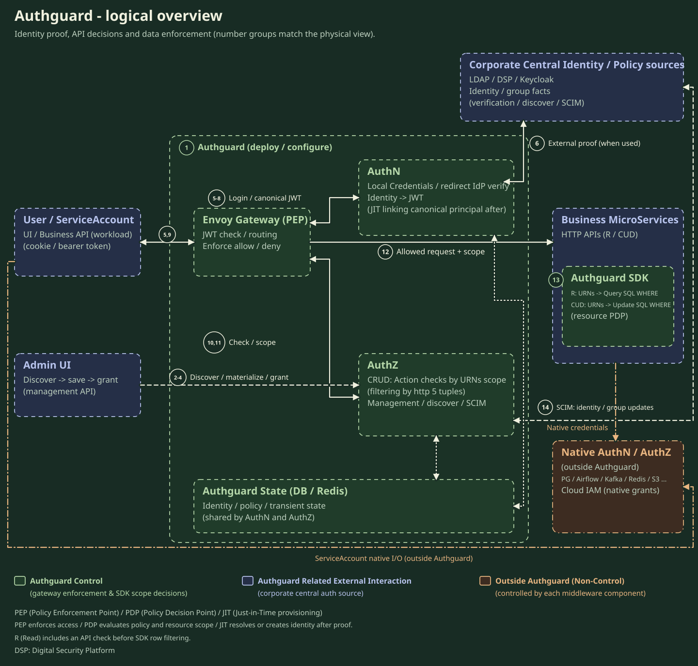

# AuthGuard

[](https://github.com/wl4g/authguard/actions/workflows/ci.yml)
[](https://www.rust-lang.org/)
[](./LICENSE)
[](https://www.rfc-editor.org/rfc/rfc6749)
[](https://openid.net/specs/openid-connect-core-1_0.html)
[](https://www.w3.org/TR/webauthn-3/)
[](https://standards.chainagnostic.org/CAIPs/caip-122)
[](https://helm.sh/)

A Rust authentication and resource-authorization platform for microservices.
Supports human and workload identities, enterprise SSO, standalone credentials,
passkeys, and wallet authentication.

## Features

- **Authentication** — OAuth2/OIDC, standalone/LDAP password login, TOTP,
  WebAuthn/passkeys, and CAIP/SIWX wallets for EVM, Solana, and Bitcoin.
- **Account linking** — one stable Principal across approved login methods.
- **Hosted Login** — application branding, account security, and static themes.
- **Resource authorization** — Envoy integration, API policy, and SQL/object scopes.
- **Enterprise integration** — Keycloak, LDAP/custom directory discovery, and
  SCIM subset ingestion.
- **Administration** — multilingual React Dashboard and `authguard console`.
- **SDKs** — Rust, Go, Java, and Python.
- **Operations and verification** — PostgreSQL/SQLite, Redis, Prometheus/OTel,
  Docker/Helm, and API/UI end-to-end suites.

## Architecture



[Physical call diagram](docs/architecture/assets/authguard-authn-authz-architecture.svg)

[Overview](docs/architecture/overview.md) · [中文](docs/architecture/overview_ZH.md)

[Design specification](docs/architecture/Authguard-AuthN-AuthZ-Whitepaper.md) · [中文](docs/architecture/Authguard-AuthN-AuthZ-Whitepaper_ZH.md)

[Responsibility matrix](docs/architecture/Authguard-AuthN-AuthZ-Whitepaper.md#access-matrix) · [Implementation status](docs/architecture/Authguard-AuthN-AuthZ-Whitepaper.md#reference-implementation)

[Identity lifecycle (JIT / pre-authorization / SCIM)](docs/architecture/Authguard-AuthN-AuthZ-Whitepaper.md#identity-lifecycle) · [Terminology](docs/architecture/Authguard-AuthN-AuthZ-Whitepaper.md#terminology)

## Quick Start

### Requirements

- Rust 1.99.1 for the pinned local, CI, and container toolchain; the workspace MSRV remains 1.91 for the optional `web3` feature
- Node.js 22+, Go 1.24+, JDK 21, and Python 3.12 for the complete test matrix
- Helm 3.17+ and a Docker-compatible builder for deployment artifacts

### Build and run

```bash
git clone https://github.com/wl4g/authguard.git
cd authguard

# Build the backend, React UI, and language modules.
make build

# Opt in to CAIP/SIWX wallet verification and Web3 dependencies.
cargo build -p authguard-cmd --features web3

# AuthN and AuthZ read the same configuration file.
./target/debug/authguard --config etc/authguard.yaml authn --bind 0.0.0.0:8082
./target/debug/authguard --config etc/authguard.yaml authz
```

The unauthenticated metadata endpoint lets clients render only enabled login
methods:

```bash
curl -fsS http://127.0.0.1:8082/.well-known/authn.json | jq
```

### Test

```bash
# Inspect the auto-selected dependency source: Aliyun behind the GFW, otherwise
# pinned official upstream images. Override with IN_CN_GFW=true|false when needed.
make image-source

# Rust, React, SDK, use-case, and Helm checks.
make test

# Full disposable Kubernetes matrix: infrastructure, AuthN, AuthZ, SDKs, Chromium UI,
# PostgreSQL, logs, metrics, and Jaeger evidence.
HTTPS_PROXY=http://127.0.0.1:8800 make e2e-k8s

# Equivalent Docker Compose matrix with native Envoy when Kubernetes is unavailable.
HTTPS_PROXY=http://127.0.0.1:8800 make e2e-docker
```

The reproducible application and verifier suite lives in
[`use-cases/customer-growth-job-service`](use-cases/customer-growth-job-service).

## Deployment

### Release artifacts

| Artifact | OCI reference | Purpose |
|---|---|---|
| Runtime | `ghcr.io/wl4g/authguard:<version>` | `authn`, `authz`, and `api` commands |
| Web UI | `ghcr.io/wl4g/authguard-web:<version>` | Static React Dashboard and Hosted Login UI |
| Helm chart | `oci://ghcr.io/wl4g/charts/authguard:<version>` | Envoy Gateway, AuthGuard, Redis Cluster, PostgreSQL, Jaeger, routes, and policies |

`make release` builds and publishes exactly these two product images and the
OCI chart, then pulls each artifact back for verification.

### Install with Helm

Create the one `authguard-secrets` payload before installing. The placeholder
file and cloud-provider variants are documented in the
[Helm chart guide](deploy/helm/authguard/README.md#2-initialise-the-secret-source).

```bash
export AUTHGUARD_NAMESPACE=authguard
export AUTHGUARD_SECRET_FILE=authguard-secrets.env
cp deploy/helm/authguard/bootstrap/authguard-secret.env.example "$AUTHGUARD_SECRET_FILE"
# Replace every placeholder with a production secret value.
deploy/helm/authguard/bootstrap/setup-secret-k8s.sh \
  --namespace "$AUTHGUARD_NAMESPACE" --secret-file "$PWD/$AUTHGUARD_SECRET_FILE"
```

Then install an immutable chart version:

```bash
helm upgrade --install authguard oci://ghcr.io/wl4g/charts/authguard \
  --version 0.1.0 \
  --namespace "$AUTHGUARD_NAMESPACE" \
  --set authguard.authn.image.repository=ghcr.io/wl4g/authguard \
  --set authguard.authz.image.repository=ghcr.io/wl4g/authguard \
  --set authguard.web.image.repository=ghcr.io/wl4g/authguard-web \
  --set secrets.kubernetes.existingSecret=authguard-secrets
```

For a single-host deployment without Kubernetes, use the
[Docker Compose topology](deploy/docker/README.md). It uses the same
`AUTHGUARD__...` secret keys as Helm.

Authentication-only deployment:

```bash
helm upgrade --install authguard oci://ghcr.io/wl4g/charts/authguard \
  --version 0.1.0 --namespace authguard --create-namespace \
  --set authguard.authz.enabled=false \
  --set envoy_gateway.ext_authz.enabled=false
```

Select an authentication-only or full deployment using the
[deployment profiles](docs/architecture/Authguard-AuthN-AuthZ-Whitepaper.md#specification).

### Configuration and secrets

Both services mount the same `authguard.authguard-config`. Supply a production
file with `--set-file authguard.authguard-config=authguard.yaml`; nested values
may also be overridden with `AUTHGUARD__...` environment variables.

Store credentials in `authguard-secrets`. Runtime fields are documented in
[`etc/authguard.yaml`](etc/authguard.yaml); chart settings and secret bootstrap
options are in the [Helm guide](deploy/helm/authguard/README.md).

## Administration and Integration

### Pre-authorize Principals and policy

Manage Principals and resource policy through the Dashboard or console:

```bash
agctl() {
  authguard console \
    --endpoint http://authguard.authguard.svc:9090 \
    --token '<api-token>' \
    "$@"
}

# Discover and materialize a federated identity before assigning policy.
agctl discover --file principal-search.json
agctl materialize --file principal-materialization.json
agctl create action --file action.json
agctl create role --file role.json
agctl create role-binding --file role-binding.json

authguard console list principals
authguard console policy get
authguard console status
```

### Protect a business service

Workload token exchange through an enterprise OAuth2 provider:

```bash
EXTERNAL_TOKEN=$(curl -fsS https://idp.example.com/oauth2/token \
  -u "${CLIENT_ID}:${CLIENT_SECRET}" \
  -d grant_type=client_credentials \
  -d audience=customer-growth-job-service | jq -r .access_token)

WORKLOAD_TOKEN=$(curl -fsS \
  https://app.example.com/auth/oauth2/corporate-oidc/token-exchange \
  -H 'content-type: application/json' \
  -d "{\"subjectToken\":\"${EXTERNAL_TOKEN}\",\"kind\":\"WORKLOAD\"}" \
  | jq -r .accessToken)

curl -fsS https://jobs.example.com/api/v1/customer-growth/jobs \
  -H "Authorization: Bearer ${WORKLOAD_TOKEN}"
```

Integrate the service with the [Rust, Go, Java, or Python SDK](src/sdk/README.md).

### Hosted Login

Configure application hosts and branding using the
[Helm integration guide](deploy/helm/authguard/README.md#4-verify-and-configure).
See the [Web guide](web/README.md) for local development and theme settings.
Repository-aware agents can use the
[`authguard-chart-integrator` skill](.agents/skills/authguard-chart-integrator/SKILL.md).

## Documentation

- [Documentation index](docs/index.md) · [中文](docs/index_ZH.md)
- [AuthN/AuthZ specification](docs/architecture/Authguard-AuthN-AuthZ-Whitepaper.md) · [中文](docs/architecture/Authguard-AuthN-AuthZ-Whitepaper_ZH.md)
- [Helm deployment](deploy/helm/authguard/README.md) · [Docker Compose](deploy/docker/README.md)
- [SDK integration](src/sdk/README.md)
- [Customer Growth reference application](use-cases/customer-growth-job-service/README.md)
- [Protocol references](docs/architecture/Authguard-AuthN-AuthZ-Whitepaper.md#references)

## License

AuthGuard is licensed under the [Apache License 2.0](LICENSE).

## Contact

For questions, proposals, and support:

- **Issues:** [github.com/wl4g/authguard/issues](https://github.com/wl4g/authguard/issues)
- **Discussions:** [github.com/wl4g/authguard/discussions](https://github.com/wl4g/authguard/discussions)
- **Security reports:** [private vulnerability report](https://github.com/wl4g/authguard/security/advisories/new)
- **Email:** <jameswong1376@gmail.com>

## Acknowledgments

AuthGuard uses these open-source projects and standards:

- [Envoy](https://www.envoyproxy.io/) · [Envoy Gateway](https://gateway.envoyproxy.io/)
- [Tokio](https://tokio.rs/) · [Axum](https://github.com/tokio-rs/axum)
- [webauthn-rs](https://github.com/kanidm/webauthn-rs) · [Chain Agnostic Standards Alliance](https://chainagnostic.org/)
- [Alloy](https://github.com/alloy-rs/alloy) · [rust-bitcoin](https://github.com/rust-bitcoin/rust-bitcoin)
- [SQLx](https://github.com/launchbadge/sqlx) · [Redis](https://redis.io/)
- [React](https://react.dev/) · [Vite](https://vite.dev/) · [Reown AppKit](https://docs.reown.com/appkit/overview)
- [OpenTelemetry](https://opentelemetry.io/) · [Prometheus](https://prometheus.io/)
