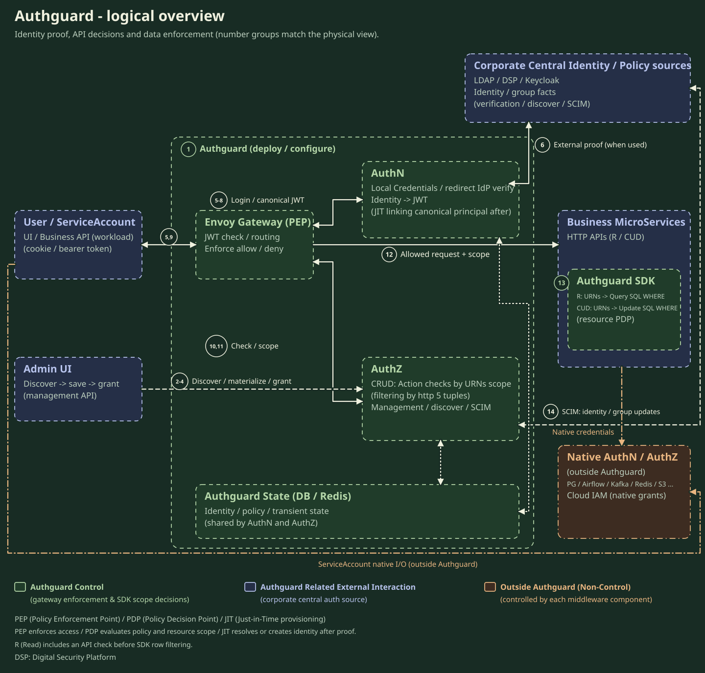
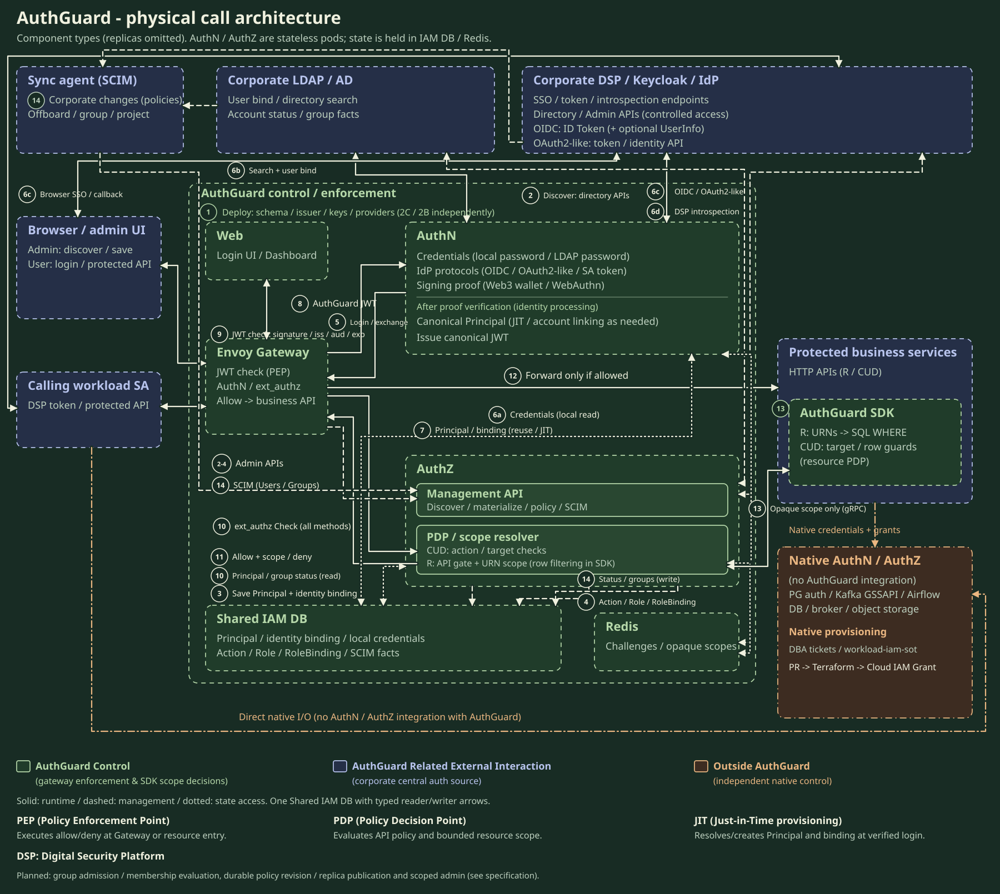

# AuthGuard Unified Authentication and Resource Authorization Specification

| Metadata | Value |
|---|---|
| Status | Initial |
| Version | 1.0 |
| Updated | 2026-11-15 |
| Type | Architecture / Interface Specification |
| Scope | AuthGuard AuthN, AuthZ, Envoy integration, and business SDK boundaries |
| Companion | [中文](Authguard-AuthN-AuthZ-Whitepaper_ZH.md) |

Contents: [Abstract](#abstract) · [Motivation](#motivation) · [Specification](#specification) · [Rationale](#rationale) · [Backwards Compatibility](#backwards-compatibility) · [Reference Implementation](#reference-implementation) · [Security Considerations](#security-considerations) · [Test Cases](#test-cases) · [References](#references)

<a id="abstract"></a>
## Abstract

AuthGuard handles authentication and resource authorization when users or workloads access business APIs. Envoy enforces ingress checks. AuthN integrates credentials and enterprise identity providers and issues a canonical token. AuthZ evaluates API permissions and resource scope; business SDKs apply that scope to SQL and object operations.

In enterprise deployments, corporate DSP owns accounts, LDAP/AD supplies approved admission, and departments manage finer permissions within that boundary. Workloads accessing databases, brokers, or cloud resources directly use the target product's native authentication and authorization, outside AuthGuard.

<a id="motivation"></a>
## Motivation

Take a large global technology company as an example. A new platform serves B2C customers and B2B employees in retail, operations, and customer service. It comprises business microservices, databases, messaging, compute, and storage. Corporate DSP manages human accounts and workload SAs; employees request LDAP/AD login and module entitlements through an enterprise service and asset management platform.

The Group's Central AD/LDAP service serves multiple distinct business lines and is not suitable for carrying fine-grained controls such as **API-level functional permissions** and **Row-level data permissions** that govern access to different modules based on staff accounts across different businesses. Departments maintain those finer permissions in the business platform UI and publish them online to AuthGuard, within corporate admission limits. B2C usually needs owner/tenant rules; B2B adds job roles, functions, and data scopes. Both require resource checks beyond page or URL access.

The same SA follows two access paths. Business API calls pass through AuthGuard, as user calls do. Direct database, Kafka topic, or bucket/object access uses native product authentication and authorization. Such grants usually follow service deployment, migration, and retirement, making DBA tickets or reviewed Git fulfillment appropriate. Account authority, request validation, and permission administration are separate responsibilities.

B2C and B2B deploy independent DSP, LDAP/AD, and AuthGuard stacks to isolate trust, data, and runtime capacity. Requests are evaluated within the application domain rather than querying corporate approval or directory services on each call.

<a id="specification"></a>
## Specification

### 1. Requirement language and deployment profiles

Uppercase MUST, MUST NOT, SHOULD, SHOULD NOT, and MAY carry the requirement levels specified by [BCP 14](https://www.rfc-editor.org/rfc/rfc8174.html). Code identifiers, URIs, and enum values are identical in both language versions.

| Profile | Account and credential authority | Authorization responsibility |
|---|---|---|
| Standalone / general internet | Explicitly enabled AuthGuard credentials, external providers, or wallets | Application owner checks or the full AuthZ model |
| Enterprise delegated / this scenario | DSP and approved corporate authentication interfaces; local Principals are projections | Corporate admission ceiling AND departmental fine policy |

Profiles define integration and governance boundaries; there is no corresponding `profile:` configuration switch. The general profile supports standalone credentials. Shipped standalone and wallet configuration requires explicit enablement.

An enterprise profile MUST prohibit independently created accounts, credentials, or alternative login paths that corporate policy has not approved. AuthGuard MAY create a canonical local projection after corporate identity verification; this does not make it a second account authority. General-purpose `first-login` behavior and corporate account governance require separate configuration and acceptance checks.

### 2. Roles and trust boundaries

<a id="terminology"></a>
| Term | Expansion | Meaning |
|---|---|---|
| AuthN / AuthZ | Authentication / Authorization | Prove identity / decide resource permission |
| PEP | Policy Enforcement Point | Enforces allow/deny; Envoy and business resource entry points |
| PDP | Policy Decision Point | Evaluates policy; AuthZ derives API/scope decisions and SDKs evaluate data scope |
| PAP | Policy Administration Point | Policy administration API/UI |
| JIT | Just-in-Time provisioning | Resolve or create a Principal and identity binding at verified login |
| SCIM | System for Cross-domain Identity Management | Synchronize user/group lifecycle changes |
| SSO / IdP | Single Sign-On / Identity Provider | Federated login / identity authority |

<a id="access-matrix"></a>
#### 2.1 Responsibility matrix

B2C/B2B identifies the business domain, USER/WORKLOAD the caller, and business API/native resource the target. These are separate dimensions; the workload rules below apply independently in both domains. Implementation status appears in [Reference Implementation](#reference-implementation).

| Caller | Target | Authentication (AuthN) | Authorization (AuthZ) | Permission administration |
|---|---|---|---|---|
| B2C user | Business API | AuthGuard integrates corporate DSP | AuthGuard required; business enforces owner/tenant scope | Corporate registration/admission and business rules |
| B2B user | Business API | AuthGuard integrates DSP/approved LDAP login | AuthGuard required; corporate module admission ∩ domain function/resource grants | Enterprise approval platform/AD for coarse grants; business UI for fine grants |
| Workload SA | Business API | AuthGuard validates/translates a DSP machine token | AuthGuard required; that SA's action/resource scope | Business UI / AuthZ management API |
| Workload SA | Self-hosted database, Kafka, storage, or other native resource | Native product authentication; no AuthGuard | DB grants, broker ACLs, etc.; no AuthGuard | Tickets → DBA / platform team |
| Workload SA | Cloud-managed database, bucket/object, or other native resource | Cloud federation/product credentials; no AuthGuard | Cloud IAM / native product policy; no AuthGuard | `workload-iam-sot` PR → Terraform |

**The target determines AuthGuard's responsibility; SA callers are not categorically excluded.** An SA used only for native resources needs no AuthGuard Principal. Both USER and WORKLOAD callers of business APIs need canonical identity and per-request authorization. They remain separate identity types; GROUP aggregates grants rather than authenticating.

#### 2.2 Service roles

<a id="enterprise-governance"></a>
An enterprise IT service and asset management (ITSM/ITAM) platform records assets and handles LDAP/AD access requests and approvals. Examples include [ServiceNow](https://www.servicenow.com/products/itsm.html), [Atlassian Jira Service Management](https://www.atlassian.com/software/jira/service-management/features/asset-and-configuration-management), [Freshworks Freshservice](https://www.freshworks.com/freshservice/), and [ManageEngine ServiceDesk Plus](https://www.manageengine.com/products/service-desk/). These names illustrate the role. Enterprises configure the directory integration, with fulfillment connectors applying approved changes to LDAP/AD; AuthGuard does not depend on a particular vendor product.

| Role | Examples | Responsibility and boundary |
|---|---|---|
| Requester | Browser, human user, Kubernetes workload/SA | Submits a proof or canonical JWT; cannot assert trusted identity, groups, or scope |
| Upstream AuthN provider / SSO | Corporate DSP, Keycloak OIDC, Entra, Okta; GitHub/WeChat in general-purpose deployments | Proves a stable external identity; its actual protocol selects OIDC, OAuth2-like, or a custom adapter |
| Corporate identity directory | LDAP/AD, Keycloak Admin API, DSP directory API | Supplies accounts, workloads, groups, status, and approved coarse entitlements; a search API is not a login protocol |
| Approval and fulfillment | ITSM/ITAM platforms, tickets/DBAs, `workload-iam-sot`/Terraform, synchronization agents | Separately govern corporate admission, native grants, and directory synchronization; stay outside per-request decisions |
| AuthN authority / token issuer | `authguard-authn` | Protocol verification, normalization, linking, and canonical JWT issuance; does not proxy business requests |
| Edge PEP | Envoy Gateway | TLS, routing, canonical JWT verification, `ext_authz`, and removal of forged context |
| Resource PDP | `authguard-authz` | Evaluates local canonical identity/admission projections and policy; returns ALLOW/DENY and bounded scope |
| Policy administration / PAP | AuthZ product API, Dashboard, console | Manages domain Action/Role/RoleBinding and source mappings without exceeding corporate ceilings |
| Resource PEP | Business service + AuthGuard SDK | Verifies scope and constrains the actual resources, SQL, and object operations behind a URL |
| Native resource PEP | Database, broker, cloud resource service, and their IAM | Enforces DB grants, topic ACLs, bucket/prefix permissions, and other native rules |

A product name does not determine its role. One Keycloak installation may expose SSO, federated LDAP/AD directory access, and its own [Authorization Services](https://www.keycloak.org/docs/latest/authorization_services/index.html). This architecture integrates the first two interfaces separately. AuthGuard AuthZ remains the resource PDP; there is no implicit call to Keycloak's PDP. LDAP role attributes do not themselves constitute AuthGuard RoleBindings.

OAuth2 **authorization server** is a token-protocol role; the AuthGuard **resource PDP** is a business-policy role. DSP names an enterprise platform, not a protocol or a mandatory extra hop between AuthN and AuthZ.

### 3. Topology and call phases

Read the logical view for responsibilities and main flows, then the physical view for interfaces, data types, and background synchronization. Both use call numbers 1–14.

The shared color legend is **AuthGuard Control (filter & SDK enforcement)**, **AuthGuard Related External Interaction (corporate central auth source)**, and **Outside AuthGuard (independent native control)**. A business host is external, while its embedded SDK is marked as an AuthGuard enforcement component. Native middleware authentication/authorization does not integrate with AuthN/AuthZ.

<a id="logical-view"></a>
#### 3.1 Logical overview



The logical view summarizes authentication, API decisions, data-scope enforcement, and corporate synchronization. State groups IAM DB/Redis responsibilities conceptually rather than colocating them in one process.

<a id="physical-view"></a>
#### 3.2 Physical calls



Each component type is drawn once; replicas are omitted. AuthN and AuthZ are stateless pods, with persistence/shared transient state in IAM DB and Redis. Management and PDP are interfaces of one AuthZ component. Typed connectors distinguish credential reads, JIT, materialization, role grants, status reads, and SCIM writes. Solid/dashed/dotted lines mean runtime/management/state access. B2C and B2B deploy independently; step 14 is background corporate permission-fact synchronization.

#### 3.3 Numbered calls

| Step | Call and result |
|---|---|
| 1 Deploy | Initialize Gateway, AuthN, AuthZ, Web, IAM DB, and Redis; configure issuer, signing keys, providers, and routes. Standalone password login also requires credential registration. |
| 2 Discover | An administrator calls `POST /api/v1/principal-discovery/search` through a controlled administration entry point. AuthZ queries LDAP, DSP directory, or Keycloak Admin live and returns candidates without persisting them. |
| 3 Materialize | Select a candidate and call `POST /api/v1/principal-discovery/materialize`. The server re-resolves the source and saves the canonical Principal and identity binding in local IAM DB. |
| 4 Pre-authorize | Configure Action, Role, and RoleBinding through policy APIs, persist and publish policy, referencing the canonical ID from step 3. R3 still applies to replica publication. |
| 5 Login entry | USER uses Hosted Login/authentication APIs; WORKLOAD uses machine token exchange. Gateway routes authentication to AuthN. Web serves login UI; business `ext_authz` is not called here. |
| 6 Verify proof | Select one configured protocol: local credential verification, LDAP user bind, OIDC/OAuth2-like, or DSP machine-token introspection. Figure branches 6a–6d are alternatives. |
| 7 Resolve / JIT | Every successful method resolves local identity bindings. Reuse the pre-authorized Principal; only create a Principal/binding atomically when linking policy allows it. JIT grants no resource permissions. |
| 8 Return JWT | AuthN issues the common JWT with `sub=principal_id` and returns it through Gateway as cookie or bearer. Upstream ID/access tokens do not go directly to AuthZ. |
| 9 Verify API identity | Each protected API request carries the canonical JWT. Gateway validates signature, issuer, audience, and lifetime without repeating AuthN/IdP login. |
| 10 Check | Gateway calls AuthZ `ext_authz`. AuthZ reads local Principal status/policy, maps the request to Action/URN, and evaluates it. |
| 11 Enforce decision | AuthZ returns allow/deny, attaching bounded scope on allow. Gateway stops a denial or installs trusted context for an allowed request. |
| 12 Forward business traffic | Gateway forwards the HTTP request directly to the microservice. AuthZ neither receives nor proxies CUD business traffic. |
| 13 Constrain data | SDKs validate scope and compile URNs into SQL/object predicates. R filters rows, U/D constrains affected rows, and C validates owner/tenant/parent. Only opaque scopes require gRPC resolution through AuthZ. |
| 14 Corporate changes (policies) | Central LDAP/DSP offboarding, disablement, or group/project changes reach a native SCIM client or synchronization agent through events/reconciliation, then SCIM Users/Groups updates AuthZ projections. New Checks use committed local status; R1/R2 remain for admission/membership evaluation. |

**Current code runs API-level `ext_authz` for protected reads and CUD, not CUD alone.** SDKs/handlers still enforce read scope and mutation targets/rows; allowing a URL is insufficient. See the [Gateway policy](../../deploy/helm/authguard/templates/gateway/security-policy.yaml), [AuthZ Check](../../src/authz/src/handler/authorization.rs#L751), and [SQL scope compiler](../../src/common/src/utils/sql.rs#L87).

Local password verification uses local credentials; LDAP requires directory search and user bind. OIDC verifies an ID Token and may query UserInfo; OAuth2-like follows its token/identity contract. Every method then resolves AuthGuard identity projections in step 7. Login availability depends on its selected upstream; authenticated business requests and directory synchronization follow separate paths.

### 4. Identity model and account linking

```text
protocol proof -> AuthenticationResult(ExternalIdentity, amr, acr, authenticated_at)
               -> identity binding / Account Linking
               -> canonical Principal -> AuthGuard JWT(sub = principal_id)
```

The unique `ExternalIdentity` key MUST be `(provider, issuer, subject)`. A `Principal` has an AuthGuard-owned, stable, bounded opaque `principal_id` and kind `USER`, `WORKLOAD`, or `GROUP`. One Principal MAY bind multiple verified login identities. Email, username, display name, ENS, and wallet brand MUST NOT trigger automatic identity merging.

<a id="identity-lifecycle"></a>
#### 4.1 JIT, pre-authorization, and subsequent synchronization

| Phase | Entry point | Local behavior |
|---|---|---|
| JIT at login | AuthN verifies LDAP/OIDC or another identity proof | Look up `(provider, issuer, subject)` first. Reuse an existing Principal; otherwise create a Principal and binding under the linking policy. JIT does not grant resource permissions. |
| Pre-authorization before login | Administrator uses the AuthZ API to search LDAP, DSP directory, Keycloak Admin, or another controlled directory interface | Re-resolve the candidate, materialize Principal + binding, then assign Role/RoleBinding. Use a newly reserved or existing canonical ID; the user need not have logged in. The first login reuses that pre-authorized binding. |
| Later lifecycle changes | Central LDAP/DSP changes reach a native SCIM client or an event/reconciliation agent that pushes Users/Groups | Update local user status, groups, and admission facts by stable identifiers. Effective authorization depends on membership evaluation, revision propagation, and TTL bounds. |

These sources expose controlled directory interfaces rather than browser tokens. AuthN and AuthZ normally share one logical IAM DB, so login can reuse a pre-authorized Principal/binding. SCIM synchronizes account/group facts; departmental Action/Role/RoleBinding changes still use management APIs. R2 records the remaining gap in PDP consumption of SCIM membership.

Creating a Principal and its first identity binding MUST be atomic, and uniqueness constraints MUST prevent double binding. An enterprise authoritative provider can create local projections only for recognized external accounts. First login through a secondary provider cannot bypass corporate identity confirmation. Account governance belongs under `accountLinking`, separate from protocol endpoints.

LDAP `uid`, AD object ID, Keycloak UUID, and OIDC `sub` MUST NOT be assumed interchangeable. Directory, SCIM, and login require a managed stable-ID crosswalk to the same canonical Principal. The Provider/issuer/subject convention for SCIM `externalId` must agree with that mapping.

`AuthenticatedPrincipalContext` carries only canonical `principalId`, `kind`, internal `stableGroupIds`, approved `trustedClaims`, `acr`, and `amr`. Provider tokens, authorization codes, passwords, raw signatures, and raw provider responses MUST NOT enter AuthZ.

The unified JWT MUST bind domain `iss`, `aud`, `sub = principal_id`, `principal_id`, `principal_kind`, `authguard_group_ids`, `amr`, `auth_time`, `iat`, and `exp`; optional `acr` may be included when trusted assurance information exists. Authentication method/time come from the verified `AuthenticationResult`. Group claims must satisfy the membership authority and revocation requirements; their field name does not establish trust. Canonical JWTs and downstream access contexts are credentials with different purposes.

<a id="central-lifecycle-sync"></a>
#### 4.2 Corporate revocation and project migration

SCIM facts originate in corporate LDAP/AD, DSP, or their identity-governance platform. A source with SCIM support may push directly; otherwise a connector consumes events or reconciles periodically and calls AuthZ `/scim/v2/Users` and `/scim/v2/Groups`. LDAP itself need not implement SCIM. The externalId, Provider/issuer, and canonical-ID mapping must agree with login/pre-authorization so changes update the original Principal rather than leave an authorized stale projection.

| Corporate or business change | Synchronization/management path | Local effect and implementation status |
|---|---|---|
| Employee departure, account disablement/deletion | SCIM User `active=false` or DELETE | Projection becomes `DISABLED`; after commit, new logins and `ext_authz` Checks deny even with an unexpired old JWT. |
| Employee transfer, group membership, or project affiliation change | SCIM Group `members` and other identity/group facts | Save projections with the goal of re-evaluating admission/data scope. Persisting `members` alone does not revoke access; PDP consumption remains R2 and the corporate gate remains R1. |
| Department role, project URN, or fine grant change | AuthZ policy API updates Role/RoleBinding and publishes a revision | Not a generic SCIM policy payload; activation follows R3 publication constraints. |
| Workload native cloud resources move projects | `workload-iam-sot` PR → Terraform → Cloud IAM Grant/revoke | Cloud/product IAM enforces the change outside AuthGuard, as shown in the figure. |

The revocation window starts at the corporate change and includes event detection/reconciliation, SCIM delivery, transactional projection, membership/policy evaluation, and cache propagation. Already issued in-flight scopes converge through invalidation or TTL; receiving a SCIM request does not instantaneously invalidate every in-flight access. See [SCIM projection](../../src/authz/src/handler/scim.rs#L12) and [Principal status checks](../../src/authz/src/handler/principal.rs#L80).

### 5. Authentication protocols

Authentication inputs fall into three verification families, separate from subsequent identity processing:

| Family | Methods | Verification responsibility |
|---|---|---|
| Credential checks | Local password, LDAP password | Verify local credentials or the LDAP user-bind result |
| IdP protocol interaction | OIDC, OAuth2-like, corporate DSP, machine tokens | Validate the upstream event/token and stable identity under its protocol |
| Signing proofs | Web3 wallets, WebAuthn | Verify client signatures bound to challenge/domain |

Only after verification does AuthN resolve the canonical Principal. JIT creation/binding and explicit account linking belong to this identity-processing stage; JWT issuance follows Principal resolution. They are not a fourth authentication method.

#### 5.1 OIDC, OAuth2-like, and corporate DSP

OIDC browser login MUST use trusted issuer discovery, Authorization Code + PKCE, state, nonce, and ID Token signature/issuer/audience/lifetime validation. Optional UserInfo MUST match the verified ID Token subject.

An OAuth2-like adapter MUST validate tokens and stable identity APIs according to its actual protocol. GitHub `/user` is not OIDC UserInfo, and an access token alone is not a verified user identity. Configuration MAY express bounded GET/POST, credential-placement, JSON-path, and identity-API differences. Proprietary DSP signatures or token translation that cannot be configured belong in a Provider SPI. An adapter MUST NOT change RoleBindings or issue a parallel Principal token.

USER uses interactive login; WORKLOAD uses machine identity. An SA obtains a DSP client-credentials or approved federation token and exchanges it for a canonical `WORKLOAD` token before calling business APIs. It does not use browser SSO or standalone user-password/TOTP flows. User delegation must be explicit; USER and SA must not be merged into one Principal.

Workload translation MUST validate trusted issuer, audience, active status/lifetime, and service-subject type. A Kubernetes SA token is usable only through explicit DSP or configured issuer/audience federation. Being inside a cluster, or selecting `kind=WORKLOAD` in a request body, is not authentication evidence. The current AuthGuard translation endpoint is a product JSON API, not a complete RFC 8693 server.

#### 5.2 LDAP/AD user authentication

`POST /auth/ldap/login` returns USER sessions only and accepts `login`, `password`, and optional `returnTo`, through separate `LdapRoutes` / `LdapHandler` structs. A read-only SA searches for one user; a bind as that user verifies the password. The resulting `amr=["pwd"]` proof reuses JIT/linking and JWT/cookie issuance. User passwords are not persisted, and failure does not fall back to standalone credentials.

LDAPS or certificate-validated StartTLS is required by default; `allowInsecure` is an explicit test setting. Empty passwords, unknown/ambiguous users, missing stable subjects, failed binds, timeouts, and disabled local Principals fail closed. Example:

```yaml
authn:
  ldap:
    enabled: true
    providerId: corporate-ldap
    issuer: ldaps://directory.example.com
    url: ldaps://directory.example.com:636
    baseDn: dc=example,dc=com
    bindDn: cn=authguard-readonly,ou=service,dc=example,dc=com
    bindPassword: ${AUTHGUARD__AUTHN__LDAP__BIND_PASSWORD}
    userFilter: "(uid={login})"
    subjectAttribute: entryUUID
  accountLinking:
    strategy: explicit
    authoritativeProviders: [corporate-ldap]
```

LDAPS uses the system trust store; a private CA bundle may be mounted and selected with `SSL_CERT_FILE`. The search credential may instead use `bindPasswordFile`; see [`etc/authguard.yaml`](../../etc/authguard.yaml) for all fields. Discovery `discovery_id`, `issuer`, and `user.id_attribute` should agree with login `providerId`, `issuer`, and `subjectAttribute`. OpenLDAP can use `entryUUID`; AD can use `objectGUID`, with binary subjects encoded as unpadded base64url. LDAP group names do not become canonical Group IDs directly.

Hosted Login discovers LDAP through public metadata and offers explicit source selection when standalone is also enabled. LDAP-only login does not require local registration or stored user passwords.

#### 5.3 Kerberos / SPNEGO enterprise SSO

The preferred integration lets the existing DSP/SSO terminate HTTP Negotiate, with AuthGuard consuming its OIDC/OAuth2-like contract. In the flow described by [RFC 4559](https://www.rfc-editor.org/rfc/rfc4559.html), `WWW-Authenticate: Negotiate` prompts browser SPNEGO exchanges. When Kerberos is selected, OS credentials obtain a ticket for the target service; **the TGT is not sent to an AuthGuard/DSP HTTP API**.

The browser must actually visit and trust the SSO origin. OS Kerberos, SPN/DNS, server credentials, and browser integrated-authentication policy must be configured. [Chromium's integration conditions](https://www.chromium.org/developers/design-documents/http-authentication/) do not mean that any DSP API call automatically carries the desktop identity. AuthN's backend HTTP client does not inherit browser credentials, and an OAuth redirect is not itself Kerberos.

Direct SPNEGO termination in AuthN is a separate optional extension and is not implemented. LDAP bind, Kerberos SSO, and OAuth2/OIDC MUST retain separate protocol boundaries.

#### 5.4 Standalone, MFA, WebAuthn, and wallets

General-purpose deployments support Argon2id passwords, RFC 6238 TOTP, WebAuthn/FIDO2, and CAIP/SIWX. Password hashes, encrypted TOTP secrets/replay counters, and WebAuthn public-key credentials share the standalone credential store. Random local IDs are stable subjects; email is only a login identifier.

OAuth state, MFA enrollment, WebAuthn ceremonies, and SIWX nonces MUST have short TTLs, atomic one-time consumption, and protocol/domain binding. EOA, Solana, and Bitcoin proofs verify locally. Only ERC-1271/6492 contract verification needs configured trusted RPC. Clients cannot supply RPC endpoints or assert `signatureValid`. Cargo's `web3` feature controls wallet dependencies. Reown/WalletConnect remains browser discovery/signing transport.

### 6. Corporate ceilings and departmental fine policy

The target enterprise decision for each protected operation is:

```text
Permit(p, a, r, c) = DomainValid(p)
                 AND PrincipalActive(p)
                 AND CentralEligibility(p, module(a), current_projection)
                 AND LocalFinePolicyAllows(p, Groups(p), a, r, c)
                 AND NOT ExplicitDeny(p, Groups(p), a, r, c)
```

`CentralEligibility` includes corporate login/module admission. A departmental ALLOW MUST NOT override missing approval, revocation, disablement, or a failed freshness requirement. Central approval can activate a module once, while domain policy controls customer, branch, tenant, and operation scopes inside it. An AD group cannot merely become another ordinary RoleBinding whose absence a local ALLOW can bypass.

The control plane MUST define explicit group-to-module gates, stable-ID crosswalks, source authority, versions, freshness, and revocation rules. Changes SHOULD reach local projections through SCIM or an independent reconciliation agent. AuthZ MUST NOT synchronously query enterprise approval platforms, LDAP, or Keycloak Admin for every business request. An agent can perform synchronization; the LDAP server need not implement SCIM itself.

Group membership MUST be trusted and revocable. Checking that a Group Principal named in a JWT is still ACTIVE does not prove that the user still belongs to that group. Saving SCIM `members` as JSON does not establish PDP consumption. Old JWTs, caches, scope TTLs, and replica propagation MUST be included in the revocation budget. Each domain/permission class must define and verify how long a last trusted projection remains usable during synchronization failure and when evaluation fails closed.

### 7. HTTP and resource policy

R denotes reads; CUD denotes create, update, and delete.

Authorization input includes canonical `principal_id`, trusted group Principal IDs, `action`, `resource_urn`, `parent_urns`, and bounded condition context. Controlled mappings MUST resolve HTTP method/host/path into Action and Resource URN. Unknown routes, unknown/disabled Principals, missing required conditions, and policy errors MUST fail closed. A tenant/resource ID submitted by a client is not proof of permission.

The local model is `Action → Role → RoleBinding`. A Role references Actions. A RoleBinding associates a USER/WORKLOAD/GROUP Principal with a Role, ALLOW/DENY, a URN pattern, and conditions. Matching explicit DENY takes precedence; absence of a matching ALLOW defaults to denial.

Reads and writes use layered decisions rather than changing identity authority by HTTP method:

| Decision/enforcement stage | Component | Read/write responsibility |
|---|---|---|
| API/resource policy PDP | AuthZ | Evaluates query admission and CUD action/resource policy and derives allow/deny scope |
| Local data-scope evaluation / scope refinement | Business AuthGuard SDK | Compiles issued URN scope into SQL WHERE/object predicates; this is a data-decision stage without authority to widen upstream grants |
| Edge PEP | Envoy `ext_authz` filter | Sends Check, enforces ALLOW/DENY, and forwards business traffic to the business service |
| Data/object PEP | Business handler and SQL/resource execution point | Applies SDK predicates to actual reads and updates/deletes, and checks owner/tenant/parent on creation |

AuthZ returns Check decisions for Envoy to enforce; CUD business traffic continues to the business service. Current code runs `ext_authz` for both reads and CUD. SDKs evaluate issued data scope rather than loading a separate complete policy catalog.

```text
urn:iam:<partition>:<service>:<region>:<tenant>:<resource-path>
urn:iam:prod:crm:global:tenant-a:store/001/customer/123
```

AuthGuard defines this hierarchy and its parent/wildcard semantics; RFC 8141 defines general URN syntax only. Exact URNs have no wildcard. A pattern `*` matches one segment; `**` is allowed only at the end of the resource path. Arbitrary regex is unsupported. Parent inheritance and collection authorization MUST agree on scope semantics.

Existing conditions cover source IP CIDR, method, secure transport, MFA, and bounded subject claims. Business tags, numeric/set operations, and time windows require separate extensions. The implementation is not a general ABAC engine. A rule requiring an unavailable trusted attribute should not match.

### 8. Scope delivery and SQL/object enforcement

AuthZ MUST bind allow/deny Resource URN scope to the canonical Principal, action, resource, policy revision, and validity period. Small contexts use a signed direct header. Large contexts use a short-lived Redis-backed opaque token resolved by SDKs through a separate gRPC listener. Direct context currently uses HMAC-SHA256; verification does not use a public-key-only business credential.

Existing access-context payloads share these fields:

```text
version, principal_id, action, resource_urn,
allow_resource_urns, deny_resource_urns, policy_revision,
issued_at_epoch_seconds, expires_at_epoch_seconds
```

Envoy MUST remove or overwrite forged identity/scope headers and stop DENY requests. SDKs MUST check signatures, versions, and lifetimes. Applications must consume context for the expected action/resource, rather than treating any valid scope as a general permission.

Business services MUST define enforcement for lists, individual objects, creates, updates, deletes, batch processing, and background tasks. SQL compilation uses server-controlled column mappings and bound parameters: business predicates AND allowed scope AND NOT denied scope. Empty allows produce deny-all. Mappings that cannot be safely expressed MUST fail. SDKs do not transparently rewrite arbitrary ORM/SQL or cover every database dialect; creates must also validate the new owner/tenant/parent.

When service A uses its SA to access B, a database, or a queue, its workload permission and the initiating user's permission are distinct constraints. User scope must not become unlimited delegation through a shared privileged SA. Delegated calls need explicit propagation, target audiences, and downstream decisions. The current product does not provide a complete generic on-behalf-of orchestration layer.

### 9. Workload access to business APIs and native resources

SA calls to business APIs MUST pass the applicable Envoy, AuthN/AuthZ, and business SDK checks, using the same Action/URN model as USER. Even a stable SA grant requires token, Principal-state, and action/resource validation on each call. Database or cloud IAM permissions do not grant business API access.

For direct native-resource access, AuthGuard takes over neither AuthN nor AuthZ:

| Resource | Authentication and authorization enforcement | Permission administration |
|---|---|---|
| Self-hosted PostgreSQL/ClickHouse, Kafka, Hadoop/HBase, Flink/Airflow, etc. | Native credentials/federation, DB grants, ACLs, or configured security plugins | Enterprise tickets fulfilled by DBA / platform teams |
| Cloud-managed databases, S3/GCS bucket/object prefixes, etc. | Cloud federation, cloud IAM, and native product policy | Project IAM policy JSON in corporate `workload-iam-sot`; reviewed PR merge triggers Terraform fulfillment through AWS/GCP/Azure IAM APIs |

The cloud workflow is `project IAM policy JSON → PR review/merge → Terraform plan/apply → cloud IAM`. Teams may change only their authorized project directories; the corporate platform governs review and Terraform execution permissions. Employee module admission approval and LDAP/AD changes use a separate workflow. SA grants generally follow service lifecycle changes and suit versioned review; credential rotation and native runtime checks remain necessary.

The boundary follows the target resource and its security interfaces, not transport alone. [ClickHouse supports HTTP/native TCP](https://clickhouse.com/docs/concepts/features/interfaces/overview), and [Airflow exposes HTTP APIs](https://airflow.apache.org/docs/apache-airflow/stable/security/api.html); their native endpoints remain in this table's scope. A management UI may reuse corporate SSO while retaining product permissions. PostgreSQL [LDAP authentication likewise does not replace database authorization](https://www.postgresql.org/docs/current/auth-ldap.html).

DSP-to-native credential mappings, database roles, SASL/GSSAPI, and cloud federation require product-specific configuration. Native products need not accept AuthGuard JWTs. Native IAM fulfillment belongs to external platforms, not AuthGuard's feature-gap list.

### 10. State, configuration, and service contracts

AuthN and AuthZ normally share one logical IAM schema. `iam_principal` is the canonical projection. AuthN owns `iam_principal_identity` and `iam_standalone_credential`; AuthZ owns `iam_action`, `iam_role`, `iam_role_action`, and `iam_role_binding`. Business resources are not copied into IAM, and transient proofs/challenges are not durable IAM entities. Enterprise admission and membership projections are target contracts requiring the data-model work identified below.

Both processes read one `authguard.yaml` and consume their own responsibilities. Precedence is `defaults < YAML < AUTHGUARD__... environment`. Shared `authguard-common` must not make AuthN or SDKs depend on AuthZ policy implementation. PostgreSQL supports shared persistence and Redis shared transient state; configuring them does not itself provide policy consistency.

| Existing contract | Purpose |
|---|---|
| `GET /auth/oauth2/{provider}/authorize`, `GET .../callback`, `POST .../link`, `POST .../token-exchange` | OAuth/OIDC and explicit linking |
| `POST /auth/ldap/login` | LDAP user-password authentication |
| `POST /auth/standalone/register`, `POST /auth/standalone/login`, plus `/auth/register`, `/auth/login` aliases | Opt-in local credentials |
| `/auth/standalone/totp/*`, `/auth/standalone/webauthn/*`, plus their short aliases | MFA and WebAuthn enrollment/assertion |
| `POST /auth/wallet/challenge`, `/verify`, `/link` | Opt-in wallet authentication |
| `GET /.well-known/authn.json`, `GET /.well-known/jwks.json` | Public capability metadata and canonical JWT public keys |
| Envoy v3 `ext_authz`; separate access-context gRPC resolver | Resource decisions; opaque scope resolution |
| AuthZ `/api/v1/*`, `/scim/v2/Users`, `/scim/v2/Groups` | Policy/Principal administration; SCIM subset ingestion |

Here `...` and `*` describe route families, not new endpoints. LDAP login is implemented; direct SPNEGO termination remains unimplemented. SCIM implements a bounded subset, not complete discovery/Bulk/filter support.

Hosted Login Web serves `GET /auth/login`, `GET /auth/account/security`, and `GET /auth/assets/*`. `/.well-known/*` and other `/auth/*` routes reach AuthN. Gateway preserves the trusted Host; `authn.applications` selects branding and allow-listed `return_to`. The token returns in an `HttpOnly; Secure; SameSite=Lax` cookie. Themes contain same-origin CSS/static assets only. Account-security operations need an existing canonical session and step-up for the same Principal; unauthenticated login must not expose Passkey enrollment.

Public login routes do not receive business `ext_authz`. Product administration APIs MUST remain separate from the health/metrics/profiling listener, which MUST NOT become a business Gateway route. Enterprise administration MUST identify and authorize administrators/synchronization agents and record audit evidence, rather than treating every bearer caller as a full administrator.

### 11. Policy administration, activation, and isolation

The business platform UI SHOULD call the AuthZ API through an authorized backend or administration entry point to maintain USER/WORKLOAD fine grants online. The service validates references and admission ceilings, writes transactionally, and publishes a new revision, without per-grant corporate approval or application redeployment. UI operations do not directly edit AuthN credentials or database tables.

Immediate effect means that the new revision is visible to serving PDPs. A successful API receipt MUST identify the published revision. Asynchronous publication must report pending activation and a propagation bound. Subsequent decisions use the active revision; in-flight scopes follow invalidation or TTL rules. Direct SQL writes do not publish policy. R3 records the current replica-consistency gap.

Policy updates MUST use durable monotonic revisions, database-level conflict detection, and bounded publication/invalidation across PDP replicas. Shared persistence, a process-local lock, and atomic installation on one replica solve different problems. An old replica must not retain revoked ALLOW indefinitely. Directory detection, projection, JWT, policy, and scope delays must jointly meet the revocation SLO.

Separate B2C/B2B deployments MUST use distinct trusted issuers/audiences, signing/HMAC keys, DSP client credentials, directory projections, IAM data, Redis namespaces, Gateway/policies, and capacity boundaries. Strong failure isolation also requires avoiding shared databases, Redis, cluster resources, and upstream failure domains that can fail together. Any cross-domain federation needs explicit design; copied credentials or default issuers do not establish isolation.

<a id="rationale"></a>
## Rationale

Corporate governance and departmental autonomy meet through an admission ceiling and delegation within it. Central approval stays auditable and revocable; fine changes track business releases. Importing AD groups as ordinary roles does not guarantee this ceiling. Moving all authority to a departmental database does not satisfy corporate governance either.

Protocol adaptation and canonical linking isolate DSP, OIDC, LDAP, and wallet differences from resource policy. Integrating Keycloak by interface reuses existing infrastructure without conflating authentication, directory data, and a second PDP into a mandatory chain.

Local projections remove central directory/approval latency from high-volume requests, but introduce synchronization and revocation budgets. Source versions, freshness, failure handling, and replica publication therefore belong in the specification. Business SDKs and native product PEPs have complementary responsibilities: unified identity does not make an HTTP Gateway a universal data-protocol enforcer.

<a id="backwards-compatibility"></a>
## Backwards Compatibility

Architecture documentation is consolidated into this specification and its Chinese counterpart; obsolete documents and references are removed. Canonical Principal, URN, HTTP routes, tokens, SCIM subset behavior, and SDK wire contracts remain unchanged. The next section identifies target capabilities not yet implemented.

Direct LDAP login adds an opt-in path to the existing pipeline. Corporate ceilings and freshness/consistency requirements still need implementation. Upgrades must explicitly reconcile group-ID mappings, policy revisions, existing RoleBindings, and local credentials with the selected enterprise profile. Renaming old configuration cannot establish conformance.

<a id="reference-implementation"></a>
## Reference Implementation

This **2026-11-15 source review includes targeted LDAP verification**. Real-directory tests cover password verification, JIT, pre-authorized binding reuse, disabled/type-mismatched Principals, and LDAPS. Corporate admission gates, effective group revocation, and replica publication remain incomplete.

### Implemented boundaries that match the design

| Source | Existing behavior |
|---|---|
| [`src/authn`](../../src/authn/src/handler/authentication.rs) | One proof → linking → JWT pipeline; OIDC/OAuth2-like and opt-in standalone/WebAuthn/wallet |
| [`migration`](../../migration/20260904195419/) | PostgreSQL/SQLite DDL and DML for canonical Principal/identity uniqueness, separate credentials and resource-policy catalog |
| [`Envoy SecurityPolicy`](../../deploy/helm/authguard/templates/gateway/security-policy.yaml) | Canonical JWT + `ext_authz` on protected business routes; `failOpen: false` |
| [`AuthZ evaluator`](../../src/authz/src/handler/policy/mod.rs) | URL-to-URN, RoleBindings, explicit DENY, and default denial |
| [`SDK / SQL`](../../src/common/src/utils/sql.rs) | Signed/opaque scopes and allow/deny SQL compilation with explicit column mapping |
| [`Principal connectors`](../../src/authz/src/handler/principal.rs) | Keycloak/LDAP/HTTP discovery and SCIM subset control-plane projection |

### Material gaps and priorities

P1 identifies work needed to uphold this scenario's governance, revocation, or consistency requirements. P2 identifies missing capabilities or integrations. These are architecture-review priorities, not verified external exploitability ratings.

| ID | Priority/status | Source evidence and impact | Required convergence |
|---|---|---|---|
| R1 | P1 | [`evaluate_request`](../../src/authz/src/handler/authorization.rs#L751) evaluates local RoleBindings directly; [`AuthorizationEvaluator`](../../src/authz/src/handler/policy/mod.rs#L69) has no independent corporate gate. A local ALLOW need not depend on corporate module approval. | Authoritative admission projection, module mapping, and an intersection that local ALLOW cannot override; constrain the control plane too. |
| R2 | P1 | [`project_authorization_context`](../../src/authn/src/handler/authentication.rs#L170) accepts internal group IDs from provider claims; [`resolve_request`](../../src/authz/src/handler/principal.rs#L80) validates only the status/kind of JWT-named Groups. SCIM [`members`](../../src/authz/src/principal/scim/model.rs#L42) become identity JSON through [`resource_claims`](../../src/authz/src/principal/scim/scim.rs#L336), without membership evaluation. Removing a member while the Group remains ACTIVE leaves old token membership usable; SCIM changes alone do not populate correct membership in a new token either. | Stable-ID crosswalk, trusted membership/admission projection, and revocation versions consumed by the PDP, or a demonstrably bounded equivalent. |
| R3 | P1 | [`PolicyRuntime`](../../src/authz/src/handler/policy/mod.rs#L284) is process-local. [`persist_and_publish`](../../src/authz/src/handler/policy/policy.rs#L627) updates only its replica. [`PostgreSQL load/replace`](../../src/common/src/storage/authz/role_postgres.rs#L239) returns `revision: 1` and replaces the catalog without durable CAS. Other replicas may retain old grants indefinitely; concurrent updates can overwrite each other and restarts lose revision continuity. | Durable revision/CAS and replica publication. UI saves should return the published revision; database commit alone cannot establish immediate activation on all replicas. |
| R4 | P1 | [`ApiAuthenticator`](../../src/authz/src/route/mod.rs#L50) protects combined policy, Principal, and SCIM APIs with one static bearer. The [`router`](../../src/authz/src/route/mod.rs#L111) does not separate administrator/provisioner authorization. Dashboard also uses the management token. | Separate administrators, provisioners, and domain scopes; trusted identities, approval constraints, and durable auditing. A DSP workload token is not currently a drop-in API credential. |
| R5 | Implemented | [`LdapRoutes`](../../src/authn/src/route/ldap.rs) / [`LdapHandler`](../../src/authn/src/handler/ldap.rs) provide search-and-user-bind, unified JWTs, metadata, and Hosted Login. | [`LDAP tests`](../../src/authn/tests/handler/ldap.rs) verify real directory and JIT/pre-authorization reuse; AuthZ discovery remains separately configured. |
| R6 | P2 | [`build_providers`](../../src/authn/src/handler/oauth2.rs#L345) rejects `type: custom`. A trait is not a shipped DSP adapter registration mechanism. Direct SPNEGO is absent. | Use existing OAuth2-like configuration where adequate; otherwise implement explicit adapter composition and real contract tests. Upstream SSO can terminate Kerberos; direct termination is separate work. |
| R7 | P2 | [`TokenExchangeRequest`](../../src/authn/src/handler/oauth2.rs#L84) lets callers select kind. [`OidcProvider`](../../src/authn/src/provider/oidc.rs#L257) introspection validates active/issuer/audience, but does not constrain USER/WORKLOAD using trusted client/subject type. A new Principal's type may therefore follow the request parameter. | Complete workload-to-business-API subject-type validation and DSP federation contracts. Native IAM/Terraform fulfillment belongs to the external platform, outside this gap. |

### Corrections to the former architecture descriptions

1. LDAP user bind belongs in AuthN; pull discovery/materialization belongs in the AuthZ control plane. Both now exist and reuse a Principal through the same identity key.
2. Calling all resource policy local omits the corporate admission ceiling; calling all permissions LDAP-managed omits delegated departmental fine policy. This specification distinguishes the levels.
3. SCIM Group updates do not establish effective membership lifecycle, PostgreSQL replicas do not establish policy synchronization, and configurable `custom` does not establish proprietary DSP support.
4. External IdPs are not categorically free of runtime dependencies: configured login and directory synchronization have different availability requirements.
5. B2C still needs authorization, native middleware is not uniformly non-HTTP, and two deployments do not alone guarantee isolation. Ownership, native enforcement, and actual failure domains must be specified.
6. Workload-to-business-API calls require AuthGuard; workload-to-native-resource calls use product authentication and authorization. SA callers cannot be categorically excluded. SDK data-scope evaluation and AuthZ API decisions are separate stages; AuthZ does not proxy CUD.
7. Business UI saves need runtime publication after management API persistence. Direct DB writes do not guarantee immediate activation across current replicas.

<a id="security-considerations"></a>
## Security Considerations

- Credential authority, admission facts, fine policy, and enforcement points MUST be explicit. Enterprise deployments cannot bypass corporate identity/admission through local signup, secondary login, or management APIs.
- Canonical identity on Envoy → AuthZ requires a verifiable ingress/internal-network boundary. Decoding an already verified JWT is not provider-token verification. Public access to business services or gRPC listeners must not bypass ingress.
- Membership removal, account disablement, module revocation, and DENY require bounded propagation. Synchronization failure cannot preserve last-known permissions indefinitely. JWTs and short-lived scopes are not instantaneous revocation protocols.
- Scope keys, HMAC secrets, and native workload credentials need domain/purpose separation. HMAC verifiers can also sign; distributing that key is not publishing JWKS.
- URLs, SQL, object prefixes, and background tasks need consistent identity/resource semantics to prevent IDOR, unfiltered batch operations, and privileged-SA confused deputies. UI visibility is not authorization evidence.
- State/nonce, return destinations, step-up, credential storage, and RPC allow lists retain protocol-specific checks. Logs/traces must exclude passwords, OTPs, provider tokens, raw signatures, and scope secrets.

<a id="test-cases"></a>
## Test Cases

| Scenario | Required result |
|---|---|
| One USER uses browser login and restricted USER token translation | Same USER Principal; wrong issuer/audience rejected |
| A USER and the application SA call business APIs separately | Distinct types and Principals; SA cannot impersonate USER, and a user token cannot declare a service identity |
| SA lacks business API action/resource permission | API denies even if the SA holds database/cloud IAM permissions |
| Directory SA bind succeeds, but user password is wrong or empty | Login fails without token issuance or password persistence |
| OS Kerberos credentials and a trusted SSO origin exist | Browser and SSO perform Negotiate; backend clients do not inherit desktop identity |
| Departmental ALLOW exists without corporate module admission | Denied; neither RoleBinding edits nor UI changes bypass the gate |
| User removed from an approved group while Group remains ACTIVE | Old JWTs, every PDP replica, and subsequent scopes stop permitting access within the declared revocation window |
| User logs in after SCIM members change | Canonical membership matches the authority; storing JSON is insufficient |
| Business UI changes a fine grant online | Management API persists and publishes; subsequent requests use the active revision in its receipt |
| Two PDPs update policy while another replica serves requests | Stale revision writes fail, revocation propagates within budget, and restart does not reset revisions |
| B2C user changes URL/SQL identifiers to another user's record | Owner/tenant checks deny across lists, writes, batches, and background paths |
| SA accesses Kafka/DB/bucket directly without its permission | Native authentication/authorization denies; AuthGuard is not called and business API grants are not reused |
| Project IAM policy PR merges in `workload-iam-sot` | Terraform fulfills authorized project IAM without changing AuthGuard business API policy |
| B2C token reaches B2B, or one domain's DSP/DB/Redis fails | Cross-domain token rejected; impact follows the declared isolation boundary |
| Provisioning-only caller attempts a RoleBinding change | Denied with auditable evidence |

Existing contracts live under [`src/authn/tests`](../../src/authn/tests), [`src/authz/tests`](../../src/authz/tests), [`src/sdk`](../../src/sdk), and the [`customer-growth reference`](../../use-cases/customer-growth-job-service). R5 real-directory tests have been executed. Enterprise conformance still requires the remaining open items and cross-component cases.

<a id="references"></a>
## References

- Structure: [ERC-3009](https://eips.ethereum.org/EIPS/eip-3009). Requirement language: [RFC 2119](https://www.rfc-editor.org/rfc/rfc2119.html), [RFC 8174](https://www.rfc-editor.org/rfc/rfc8174.html).
- OAuth/OIDC: [RFC 6749](https://www.rfc-editor.org/rfc/rfc6749.html), [PKCE / RFC 7636](https://www.rfc-editor.org/rfc/rfc7636.html), [Introspection / RFC 7662](https://www.rfc-editor.org/rfc/rfc7662.html), [Token Exchange / RFC 8693](https://www.rfc-editor.org/rfc/rfc8693.html), [Security BCP / RFC 9700](https://www.rfc-editor.org/rfc/rfc9700.html), [OpenID Connect Core](https://openid.net/specs/openid-connect-core-1_0.html).
- Directories and enterprise SSO: [LDAP / RFC 4511](https://www.rfc-editor.org/rfc/rfc4511.html), [Kerberos / RFC 4120](https://www.rfc-editor.org/rfc/rfc4120.html), [HTTP Negotiate / RFC 4559](https://www.rfc-editor.org/rfc/rfc4559.html), [SCIM Schema / RFC 7643](https://www.rfc-editor.org/rfc/rfc7643.html), [SCIM Protocol / RFC 7644](https://www.rfc-editor.org/rfc/rfc7644.html).
- Authenticators: [TOTP / RFC 6238](https://www.rfc-editor.org/rfc/rfc6238.html), [WebAuthn](https://www.w3.org/TR/webauthn-3/), [CAIP-122](https://standards.chainagnostic.org/CAIPs/caip-122), [ERC-4361](https://eips.ethereum.org/EIPS/eip-4361), [ERC-1271](https://eips.ethereum.org/EIPS/eip-1271), [ERC-6492](https://eips.ethereum.org/EIPS/eip-6492), [BIP-322](https://github.com/bitcoin/bips/blob/master/bip-0322.mediawiki).
- Resources and enforcement: [URN / RFC 8141](https://www.rfc-editor.org/rfc/rfc8141.html), [Envoy External Authorization](https://www.envoyproxy.io/docs/envoy/latest/api-v3/service/auth/v3/external_auth.proto).

## Copyright

This design document follows the repository's [Apache License 2.0](../../LICENSE).
