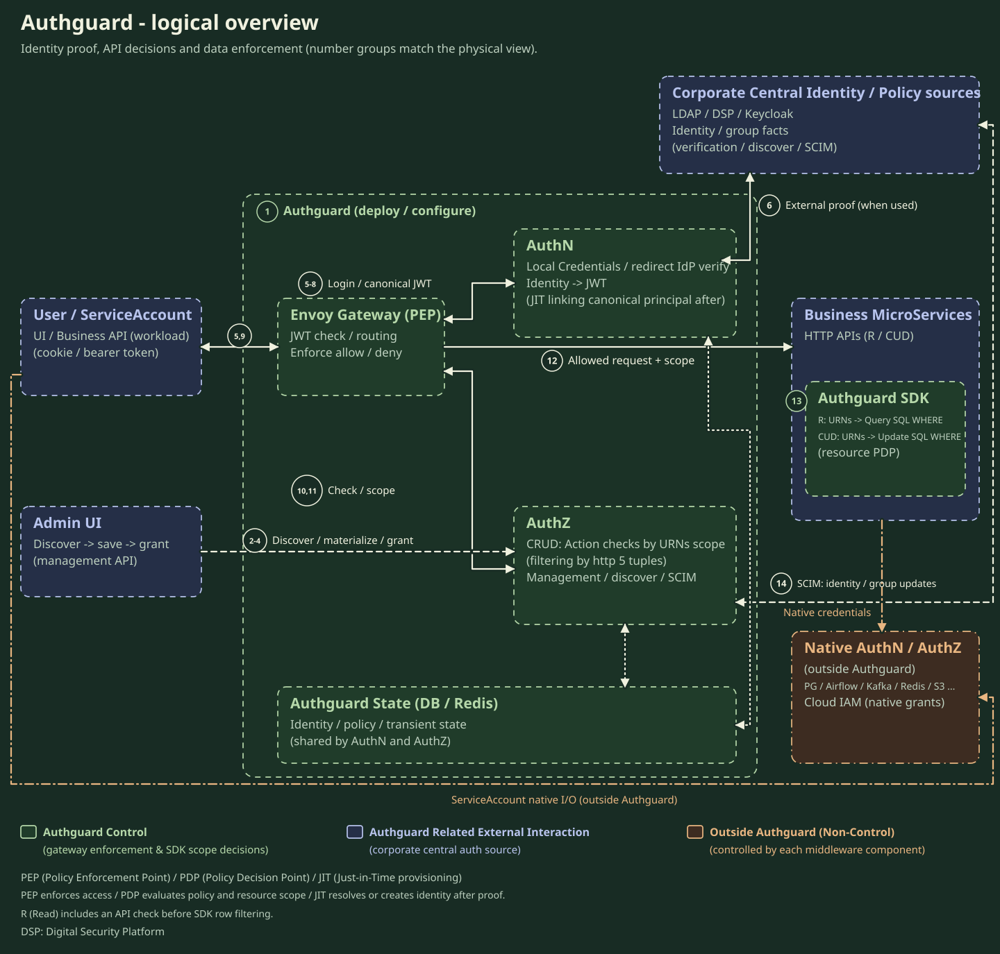
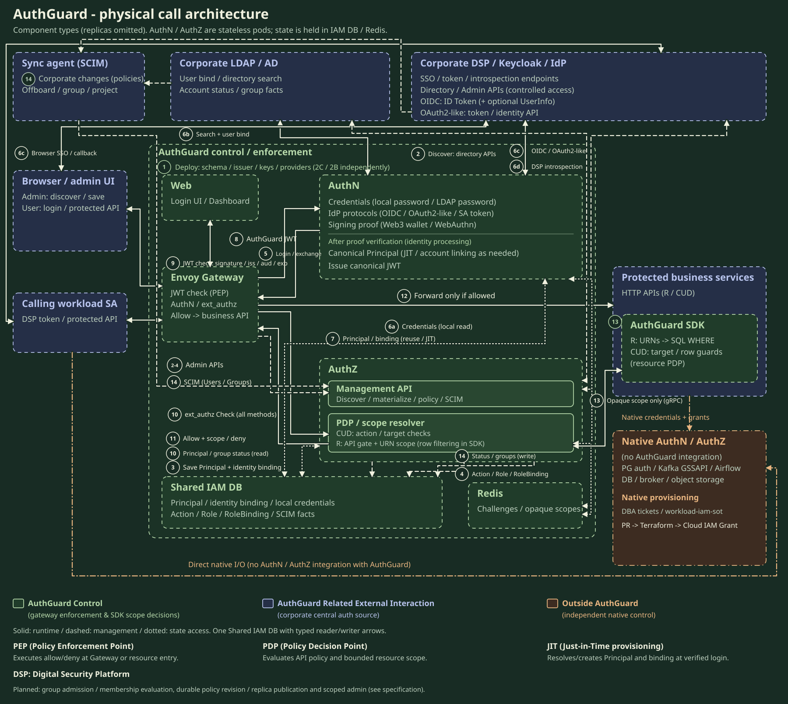

# AuthGuard 统一认证与资源级鉴权设计规范

| 元数据 | 内容 |
|---|---|
| 状态 | Initial |
| 版本 | 1.0 |
| 更新日期 | 2026-11-15 |
| 类型 | Architecture / Interface Specification |
| 范围 | AuthGuard AuthN、AuthZ、Envoy 集成与业务 SDK 边界 |
| 对照版本 | [English](Authguard-AuthN-AuthZ-Whitepaper.md) |

目录：[Abstract](#abstract) · [Motivation](#motivation) · [Specification](#specification) · [Rationale](#rationale) · [Backwards Compatibility](#backwards-compatibility) · [Reference Implementation](#reference-implementation) · [Security Considerations](#security-considerations) · [Test Cases](#test-cases) · [References](#references)

<a id="abstract"></a>
## Abstract（摘要）

AuthGuard 统一处理用户和工作负载访问业务 API 时的认证与资源授权。Envoy 执行入口检查；AuthN 对接登录凭据和企业身份源，签发统一令牌；AuthZ 判定接口权限和资源范围，业务 SDK 将范围落实到 SQL 与对象操作。

企业模式下，集团 DSP 管理账号，LDAP/AD 承载获批的业务准入，部门管理准入范围内的细粒度权限。工作负载直接访问数据库、消息系统和云资源时，使用目标产品的原生认证授权，不经过 AuthGuard。

<a id="motivation"></a>
## Motivation（动机）

以一家全球级大型科技公司为例，新平台既服务大量 2C 用户，也供门店、运营和客户服务等 2B 人员使用。平台包含业务微服务及数据库、消息、计算和存储中间件。用户账号和 workload SA 由集团 DSP 统一管理，员工通过企业服务与资产管理平台申请 LDAP/AD 中的登录和模块开通权限。

集团的 Central AD/LDAP 服务于多条不同的业务线，不适合承载按不同业务员工账户访问不同模块的 **API 级功能权限** 和 **Rows 级数据权限**这种细粒度控制。这些权限由部门在业务平台 UI 中维护，受集团准入约束，并在线发布到 AuthGuard。2C 通常只需 Owner 规则；2B 则需按不同岗位职级划分功能和数据权限，且两者都需按具体资源过滤，不仅只是控制页面或 HTTP URL。

同一个 SA 有两条不同的访问链路：调用业务 API 时，和用户一样经过 AuthGuard；访问数据库、Kafka topic 或 bucket/object prefix 时，由产品原生机制认证鉴权。后者的授权通常随服务部署、迁移和下线调整，适合 DBA 工单或 Git 审阅后履约。账号由谁管理、请求由谁校验、权限在哪里配置，需要分别确定。

2C 与 2B 分别部署 DSP、LDAP/AD 和 AuthGuard，隔离身份信任、数据与运行容量。业务请求在域内完成判定，不逐次访问集团审批或目录系统。

<a id="specification"></a>
## Specification（规范）

### 1. 规范用语与适用模式

大写 MUST、MUST NOT、SHOULD、SHOULD NOT、MAY 使用 [BCP 14](https://www.rfc-editor.org/rfc/rfc8174.html) 定义的要求等级。代码标识、URI 和枚举值在两个语言版本中保持一致。

| 模式 | 身份与凭据权威 | 授权责任 |
|---|---|---|
| Standalone / 通用互联网模式 | 显式启用的 AuthGuard 本地凭据、外部 Provider 或钱包 | 业务自身 owner 检查，或完整 AuthZ 模型 |
| Enterprise delegated / 本文企业场景 | DSP 与获准的企业认证接口；本地 Principal 是投影 | 集团粗粒度准入上限 AND 部门细粒度策略 |

模式定义接入与治理边界，当前没有对应的 `profile:` 配置开关。通用模式支持 standalone；发行配置中的 standalone 和 wallet 均需显式启用。

企业模式 MUST 禁止独立创建或使用未经集团认可的本地账号、登录凭据或替代认证路径。AuthGuard 可以为已经由集团验证的账号创建内部 canonical Principal 投影，但不得因此成为第二套账号权威。通用模式下的 `first-login` 与企业账号治理需要分别配置和验收。

### 2. 角色与信任边界

<a id="terminology"></a>
| 术语 | 全称 | 含义 |
|---|---|---|
| AuthN / AuthZ | Authentication / Authorization | 认证身份 / 判定资源权限 |
| PEP | Policy Enforcement Point | 执行允许/拒绝；本系统包括 Envoy 和业务资源入口 |
| PDP | Policy Decision Point | 计算策略结果；AuthZ 判定接口与范围，SDK 求值数据范围 |
| PAP | Policy Administration Point | 管理策略的 API/UI |
| JIT | Just-in-Time provisioning | 身份验证后，在登录时解析或创建 Principal 与 identity binding |
| SCIM | System for Cross-domain Identity Management | 同步用户、组及生命周期变化 |
| SSO / IdP | Single Sign-On / Identity Provider | 单点登录 / 身份提供方 |

<a id="access-matrix"></a>
#### 2.1 接入责任矩阵

2C/2B 是业务域，USER/WORKLOAD 是调用主体，业务 API/原生资源是访问目标。三个维度分别处理；下表的 workload 规则在两个域分别适用。实现状态见 [Reference Implementation](#reference-implementation)。

| 调用主体 | 访问目标 | 认证（AuthN） | 鉴权（AuthZ） | 授权管理 |
|---|---|---|---|---|
| 2C 用户 | 业务 API | 经 AuthGuard 接入集团 DSP | AuthGuard 必经；业务执行 owner/tenant 范围 | 集团注册/准入规则、业务规则 |
| 2B 用户 | 业务 API | 经 AuthGuard 接入 DSP/获准的 LDAP 登录 | AuthGuard 必经；集团模块准入 ∩ 部门功能/资源权限 | 企业审批平台/AD 管粗权限，业务 UI 管细权限 |
| Workload SA | 业务 API | AuthGuard 验证/转换 DSP 机器令牌 | AuthGuard 必经；校验该 SA 的 action/resource 范围 | 业务 UI / AuthZ 管理 API |
| Workload SA | 自建数据库、Kafka、存储等原生资源 | 产品原生认证；AuthGuard 不参与 | DB grants、broker ACL 等；AuthGuard 不参与 | 工单 → DBA / 平台团队 |
| Workload SA | 云托管数据库、bucket/object 等原生资源 | 云身份联邦/产品凭据；AuthGuard 不参与 | 云 IAM / 产品原生策略；AuthGuard 不参与 | `workload-iam-sot` PR → Terraform |

**是否接入 AuthGuard 由访问目标决定，不能按“用户接入、SA 排除”划分。** 仅访问原生资源的 SA 无需建立 AuthGuard Principal；访问业务 API 的 USER 和 WORKLOAD 都需要 canonical 身份与逐请求授权。两类身份分别建模，GROUP 仅用于授权归组。

#### 2.2 服务角色

<a id="enterprise-governance"></a>
企业服务与资产管理（ITSM/ITAM）平台在此负责集中记录资产、受理 LDAP/AD 权限申请与审批。例如 [ServiceNow](https://www.servicenow.com/products/itsm.html)、[Atlassian Jira Service Management](https://www.atlassian.com/software/jira/service-management/features/asset-and-configuration-management)、[Freshworks Freshservice](https://www.freshworks.com/freshservice/) 和 [ManageEngine ServiceDesk Plus](https://www.manageengine.com/products/service-desk/)。这些名称仅作角色示例；具体目录集成由企业配置，获批变更经履约连接器写入 LDAP/AD，AuthGuard 不依赖某一厂商产品。

| 角色 | 示例 | 职责与边界 |
|---|---|---|
| 请求者 | 浏览器、人类用户、Kubernetes workload/SA | 提交证明或 canonical JWT；不能自报受信身份、组或授权范围 |
| 上游 AuthN Provider / SSO | 企业 DSP、Keycloak OIDC、Entra、Okta；通用模式下的 GitHub/WeChat | 证明稳定外部身份；实际协议决定使用 OIDC、OAuth2-like 或自定义 Adapter |
| 企业身份目录 | LDAP/AD、Keycloak Admin API、DSP 目录 API | 提供用户、工作负载、组、状态与经批准的粗粒度权限事实；查询接口不是登录协议 |
| 审批与履约系统 | ITSM/ITAM 平台、工单/DBA、`workload-iam-sot`/Terraform、同步代理 | 分别管理集团准入、原生资源授权与目录同步；不参与逐请求判定 |
| AuthN authority / token issuer | `authguard-authn` | 协议验证、身份规范化、账号绑定、canonical JWT 签发；不代理业务请求 |
| 入口 PEP | Envoy Gateway | TLS、路由、canonical JWT 验证、`ext_authz`、移除伪造上下文 |
| 资源 PDP | `authguard-authz` | 根据本地 canonical 身份/准入投影与策略判定，返回 ALLOW/DENY 和 bounded scope |
| 策略管理面 / PAP | AuthZ 产品 API、Dashboard、console | 管理域内 Action/Role/RoleBinding 与来源映射；企业模式下不得突破集团权限上限 |
| 资源 PEP | 业务服务 + AuthGuard SDK | 验证授权上下文，对 URL 对应的真实资源及 SQL/对象操作执行约束 |
| 原生资源 PEP | 数据库、broker、云资源服务及其 IAM | 执行 DB grants、topic ACL、bucket/prefix 权限等原生规则 |

产品名称不决定角色。同一 Keycloak 可以提供 SSO、联邦 LDAP/AD 查询与自己的 [Authorization Services](https://www.keycloak.org/docs/latest/authorization_services/index.html)；本架构分别接入前两种接口，资源 PDP 仍为 AuthGuard AuthZ，不隐式调用 Keycloak 的 PDP。LDAP 中的角色属性也不等于已经存在 AuthGuard RoleBinding。

OAuth2 **authorization server** 是令牌协议角色；AuthGuard **resource PDP** 是业务资源判定角色。DSP 是企业平台名称，不是协议，也不是 AuthN 与 AuthZ 之间必须增加的一跳。

### 3. 总体拓扑与调用阶段

先看逻辑图中的职责与主调用，再用物理图追踪接口、数据类型及后台同步。两图沿用 1–14 的调用编号。

三色图例统一为 **AuthGuard Control (filter & SDK enforcement)**、**AuthGuard Related External Interaction (corporate central auth source)** 和 **Outside AuthGuard (independent native control)**。业务宿主属于交互方，其内嵌 SDK 单独标为 AuthGuard 执行组件；原生中间件的认证鉴权不与 AuthN/AuthZ 集成。

<a id="logical-view"></a>
#### 3.1 逻辑概览



逻辑图归纳认证、接口决策、数据范围执行与集团同步；State 合并表示 IAM DB/Redis 的职责，不表示它们部署在同一进程。

<a id="physical-view"></a>
#### 3.2 物理调用



物理图每种组件只画一次，多副本省略。AuthN 与 AuthZ 均为 stateless Pod，持久化/共享瞬态状态外置到 IAM DB 与 Redis；AuthZ 管理 API 和 PDP 是同一组件的不同接口。连线分别标识凭据读取、JIT、预授权物化、角色绑定、状态读取及 SCIM 写入。实线/虚线/点线表示运行时/管理/状态访问。2C、2B 独立部署；第 14 步是后台集团权限事实同步。

#### 3.3 编号调用说明

| 步骤 | 调用与结果 |
|---|---|
| 1 部署 | 初始化 Gateway、AuthN、AuthZ、Web、IAM DB 与 Redis，配置 issuer、签名密钥、Provider 和路由；standalone 密码登录还需先注册凭据。 |
| 2 Discover | 管理员经受控管理入口调用 `POST /api/v1/principal-discovery/search`，AuthZ 联机查询 LDAP、DSP 目录或 Keycloak Admin API，返回候选；查询不写库。 |
| 3 Materialize | 管理员选中候选并调用 `POST /api/v1/principal-discovery/materialize`；服务端重新解析来源，在本地 IAM DB 保存 canonical Principal 与 identity binding。 |
| 4 预授权 | 通过策略 API 配置 Action、Role、RoleBinding，并持久化/发布策略；绑定引用第 3 步的 canonical ID。跨副本发布仍有 R3 差距。 |
| 5 登录入口 | USER 经 Hosted Login/认证 API，WORKLOAD 经机器 token-exchange；Gateway 将认证请求路由到 AuthN。登录 UI 由 Web 提供，此阶段不调用业务 `ext_authz`。 |
| 6 验证证明 | 按配置选择一种协议：本地凭据查询/验签、LDAP 用户 bind、OIDC/OAuth2-like 协议，或 DSP 机器令牌 introspection。图中的 6a–6d 是可选分支。 |
| 7 解析 / JIT | 所有成功认证都查本地 identity binding。已预授权的主体直接复用；未绑定身份仅在 linking 策略允许时原子创建 Principal/binding。JIT 不自动授予资源权限。 |
| 8 返回 JWT | AuthN 签发 `sub=principal_id` 的统一 JWT，经 Gateway 返回客户端，使用 cookie 或 bearer。上游 ID Token/access token 不直接交给 AuthZ。 |
| 9 业务入口校验 | 每次受保护 API 请求携带统一 JWT；Gateway 校验签名、issuer、audience 和有效期。此时不重新登录 AuthN/IdP。 |
| 10 Check | Gateway 调用 AuthZ `ext_authz`。AuthZ 读取本地 Principal 状态与策略，把请求映射到 Action/URN 并判定。 |
| 11 执行判定 | AuthZ 返回允许/拒绝，允许时附带有界 scope；Gateway 拒绝则终止，允许则装入受信上下文。 |
| 12 转发业务请求 | Gateway 把业务 HTTP 请求直接交给微服务；AuthZ 不接收或代理 CUD 业务流量。 |
| 13 数据约束 | 业务 SDK 验证 scope，将 URN 范围转换为 SQL/对象谓词。R 过滤读取范围，U/D 限制受影响行，C 验证新对象 owner/tenant/parent；opaque scope 才经 gRPC 向 AuthZ 解析。 |
| 14 集团策略变更同步 | 集团 LDAP/DSP 的离职、禁用或组/项目归属变化，由原生 SCIM client 或同步代理读取事件/对账，经 SCIM Users/Groups 写入 AuthZ 的本地投影。落库后新 Check 使用本地状态；组/准入事实参与判定仍有 R1/R2 差距。 |

**当前实现对受保护的 R 和 CUD 都执行接口级 `ext_authz`，不是仅检查 CUD。** R 的行范围及 CUD 的目标/行约束仍需业务 SDK/处理器落实，URL 放行不能替代它们。接口契约见 [Gateway 策略](../../deploy/helm/authguard/templates/gateway/security-policy.yaml)、[AuthZ Check](../../src/authz/src/handler/authorization.rs#L751) 与 [SQL scope 编译](../../src/common/src/utils/sql.rs#L87)。

本地密码校验只使用本地 credential 数据；LDAP 校验需要目录查询和用户 bind；OIDC 验证 ID Token 并可查询 UserInfo，OAuth2-like 按实际 token/identity 契约取稳定身份。无论来源如何，第 7 步都要回到 AuthGuard 身份投影。登录依赖所选上游的可用性；已认证业务请求与目录同步分属不同路径。

### 4. 身份模型与账号绑定

```text
protocol proof -> AuthenticationResult(ExternalIdentity, amr, acr, authenticated_at)
               -> identity binding / Account Linking
               -> canonical Principal -> AuthGuard JWT(sub = principal_id)
```

`ExternalIdentity` 的唯一键 MUST 是 `(provider, issuer, subject)`。`Principal` 使用 AuthGuard 内部稳定、有界的 opaque `principal_id`，类别为 `USER`、`WORKLOAD` 或 `GROUP`。一个 Principal MAY 绑定多个经过验证的登录身份。email、用户名、display name、ENS 或钱包品牌 MUST NOT 用作自动合并身份的依据。

<a id="identity-lifecycle"></a>
#### 4.1 JIT、预授权与后续同步

| 时点 | 入口 | 本地处理 |
|---|---|---|
| 登录时 JIT | AuthN 验证 LDAP/OIDC 等身份证明 | 先按 `(provider, issuer, subject)` 查 binding；存在则复用 Principal，不存在时按 linking 策略创建 Principal 和 binding。JIT 不自动授予资源权限。 |
| 登录前预授权 | 管理员在 UI 中经 AuthZ 管理 API 搜索 LDAP、DSP 目录或 Keycloak Admin 等接口 | 服务端重新解析候选并物化为本地 Principal + binding，再配置 Role/RoleBinding。使用新预分配或已存在的 canonical ID；不要求用户已经登录。首次登录按同一 binding 复用预授权主体。 |
| 后续生命周期变化 | 集团 LDAP/DSP 变更，经原生 SCIM client 或独立代理读取事件/对账并 push Users/Groups | 按稳定标识更新用户状态、组和准入事实的本地投影，供授权使用；生效时效受成员关系实现、版本传播与 TTL 约束。 |

LDAP/AD、DSP、Keycloak 在这里暴露的是受控目录接口，而非浏览器 token。AuthN 与 AuthZ 默认使用同一逻辑 IAM DB，预授权写入的 Principal/binding 可直接被登录链路复用。SCIM 同步账号与组事实，部门 Action/Role/RoleBinding 仍通过管理 API 更新；SCIM 成员关系参与 PDP 判定的差距见 R2。

首次创建 Principal 与 identity binding MUST 原子提交，唯一约束 MUST 防止同一外部身份绑定多个 Principal。企业 authoritative Provider 只能为已获认可的外部账号产生本地投影；secondary Provider 的首次登录不得绕过集团身份确认。账号绑定策略属于 `accountLinking`，不得混入协议端点配置。

LDAP `uid`、AD object ID、Keycloak UUID 与 OIDC `sub` MUST NOT 默认视为同一标识。目录、SCIM 与登录链路需要经管理的稳定标识映射，最终指向相同 canonical Principal；SCIM `externalId` 的 Provider/issuer/subject 约定必须与该映射一致。

`AuthenticatedPrincipalContext` 只携带 canonical `principalId`、`kind`、内部 `stableGroupIds`、受信 `trustedClaims`、`acr` 与 `amr`。外部 token、authorization code、密码、签名原文和原始 Provider JSON MUST NOT 进入 AuthZ。

统一 JWT MUST 绑定域内 `iss`、`aud`、`sub = principal_id`、`principal_id`、`principal_kind`、`authguard_group_ids`、`amr`、`auth_time`、`iat` 与 `exp`；有可信 assurance 信息时可包含可选的 `acr`。认证方式和时间来自已验证的 `AuthenticationResult`；group claim 必须满足本规范的成员关系权威与撤销要求，不能仅凭字段名称获得信任。Canonical JWT 和下游 access context 是不同用途的凭据。

<a id="central-lifecycle-sync"></a>
#### 4.2 集团撤权与项目迁移

SCIM 的来源是集团维护的 LDAP/AD、DSP 或其身份治理平台。源平台支持 SCIM 时可直接 push；否则由连接器读取变更事件或定期对账，再调用 AuthZ 的 `/scim/v2/Users`、`/scim/v2/Groups`。LDAP 服务器本身无需实现 SCIM。外部 `externalId`、Provider/issuer 与 canonical ID 的映射必须和登录/预授权一致，才能更新原主体而非留下仍有权限的旧投影。

| 集团或业务变更 | 同步/管理路径 | 本地效果与实现状态 |
|---|---|---|
| 员工离职、账号禁用/删除 | SCIM User `active=false` 或 DELETE | 投影成为 `DISABLED`；落库后的新登录和 `ext_authz` Check 拒绝，即使旧 JWT 仍在有效期内。 |
| 员工调岗、组成员或项目归属变化 | SCIM Group `members` 等身份/组事实更新 | 保存本地投影，目标是重新计算准入与数据范围；当前仅存下 `members` 不足以撤权，PDP 消费仍需 R2，集团准入 gate 仍需 R1。 |
| 部门角色、项目 URN 或细粒度授权变化 | AuthZ 策略管理 API 更新 Role/RoleBinding 并发布 revision | 不作为通用 SCIM policy payload；生效受 R3 所述策略发布约束。 |
| Workload 原生云资源随项目迁移 | `workload-iam-sot` PR → Terraform → Cloud IAM Grant/revoke | 由云平台/产品 IAM 执行，属于图中 AuthGuard 之外的路径。 |

撤权窗口从集团变更产生开始计算，包含事件检测/对账、SCIM 交付、事务落库、成员/策略求值及缓存传播。已签发且在途的 scope 按失效机制或 TTL 收敛；不能把“收到 SCIM 请求”写成所有在途访问瞬时失效。上述禁用检查代码见 [SCIM 投影](../../src/authz/src/handler/scim.rs#L12)与 [Principal 状态检查](../../src/authz/src/handler/principal.rs#L80)。

### 5. 认证协议

认证输入按验证方式分为三类，与后续身份处理分开：

| 类别 | 方法 | 验证职责 |
|---|---|---|
| 凭据校验 | local password、LDAP password | 验证本地密码或 LDAP 用户 bind 结果 |
| IdP 协议交互 | OIDC、OAuth2-like、企业 DSP、机器令牌 | 按协议验证上游认证事件、令牌与稳定身份 |
| Signing 证明交互 | Web3 wallet、WebAuthn | 验证 challenge/domain 绑定的客户端签名证明 |

验证成功后才解析 canonical Principal；JIT 创建/绑定与显式 account linking 是这一身份处理阶段的操作，JWT 在 Principal 解析后签发。它们不是第四类认证方法。

#### 5.1 OIDC、OAuth2-like 与企业 DSP

OIDC 浏览器登录 MUST 使用发现的受信 issuer、Authorization Code + PKCE、state、nonce，以及 ID Token 签名、issuer、audience 和时效校验；可选 UserInfo 的 subject MUST 与已验证的 ID Token 一致。

OAuth2-like Adapter MUST 按实际协议校验 token 和稳定身份接口；GitHub `/user` 不是 OIDC UserInfo，access token 本身也不能被当成已验证的用户身份。配置可以覆盖有限的 GET/POST、credential placement、JSON 字段路径与 identity API 差异；不能表达的 DSP 签名或 token translation 通过 Provider SPI 实现。Adapter MUST NOT 修改 RoleBinding 或自行签发旁路 Principal token。

USER 使用交互登录，WORKLOAD 使用机器身份：SA 通过 DSP client credentials 或获准的身份联邦取得令牌，调用业务 API 前由 AuthN 转换为 `WORKLOAD` canonical token，不走浏览器 SSO 或 standalone 用户密码/TOTP 流程。用户委托需显式传递，不能把 USER 与 SA 合并为一个 Principal。

工作负载令牌转换 MUST 验证受信 issuer、audience、有效状态/期限及服务主体类型。Kubernetes SA token 只有在 DSP 或已配置的身份联邦明确信任其 issuer/audience 后才能使用；“来自集群”或请求体中的 `kind=WORKLOAD` 不是认证证据。当前 AuthGuard 转换 API 是产品 JSON 接口，不得宣称是完整 RFC 8693 Server。

#### 5.2 LDAP/AD 用户认证

`POST /auth/ldap/login` 只返回 USER 会话，接收 `login`、`password` 和可选 `returnTo`，使用独立的 `LdapRoutes` / `LdapHandler`。流程为只读 SA 搜索唯一用户、以用户 DN/password bind，再产生 `amr=["pwd"]` 的认证结果，复用 JIT/linking 和 JWT/cookie 输出。用户密码不写入本地凭据库，失败不回退到 standalone。

默认要求 LDAPS 或验证证书的 StartTLS；`allowInsecure` 只用于显式测试环境。空密码、未知/重复用户、缺少稳定 subject、bind 失败、超时及本地 disabled Principal 均拒绝。配置示例：

```yaml
authn:
  ldap:
    enabled: true
    providerId: corporate-ldap
    issuer: ldaps://directory.example.com
    url: ldaps://directory.example.com:636
    baseDn: dc=example,dc=com
    bindDn: cn=authguard-readonly,ou=service,dc=example,dc=com
    bindPassword: ${AUTHGUARD__AUTHN__LDAP__BIND_PASSWORD}
    userFilter: "(uid={login})"
    subjectAttribute: entryUUID
  accountLinking:
    strategy: explicit
    authoritativeProviders: [corporate-ldap]
```

LDAPS 使用系统信任库；企业私有 CA 可通过 `SSL_CERT_FILE` 指向挂载的 CA bundle。查询凭据也可通过 `bindPasswordFile` 提供；完整字段见 [`etc/authguard.yaml`](../../etc/authguard.yaml)。LDAP 预授权 discovery 的 `discovery_id`、`issuer`、`user.id_attribute` 应与 `providerId`、`issuer`、`subjectAttribute` 一致。OpenLDAP 可用 `entryUUID`；AD 可用 `objectGUID`，二进制 subject 统一编码为无 padding 的 base64url。LDAP 组名不会直接作为 canonical Group ID 写入 JWT。

Hosted Login 通过公开 metadata 发现 LDAP；同时启用 standalone 时，用户显式选择来源。只有 LDAP 时不需要启用本地注册或保存用户密码。

#### 5.3 Kerberos / SPNEGO 企业免密 SSO

推荐由现有 DSP/SSO 端点终止 HTTP Negotiate，AuthGuard 通过其 OIDC/OAuth2-like 契约消费认证结果。[RFC 4559](https://www.rfc-editor.org/rfc/rfc4559.html) 描述的 `WWW-Authenticate: Negotiate` 使浏览器交换 SPNEGO token；选择 Kerberos 时，系统凭据用于取得针对目标服务的票据，**TGT 不发送给 AuthGuard/DSP 的 HTTP API**。

浏览器必须实际访问并信任该 SSO origin，且 OS Kerberos、SPN/DNS、服务凭据和浏览器集成认证策略必须配置正确；[Chromium 的集成认证条件](https://www.chromium.org/developers/design-documents/http-authentication/) 不能被概括为“任意 DSP API 调用都会自动带上当前桌面身份”。AuthN 后端的 HTTP client 不会继承浏览器登录态，OAuth redirect 也不是 Kerberos 协议本身。

直接由 AuthN 终止 SPNEGO 是另一项可选扩展，当前未实现。LDAP bind、Kerberos SSO、OAuth2/OIDC 三者 MUST 保持独立协议边界。

#### 5.4 Standalone、MFA、WebAuthn 与钱包

通用模式支持 Argon2id password、RFC 6238 TOTP、WebAuthn/FIDO2 与 CAIP/SIWX。password hash、加密 TOTP secret/replay counter、WebAuthn 公钥凭据属于唯一的 standalone credential 存储；稳定 subject 使用随机本地 ID，email 只是登录标识。

OAuth state、MFA enrollment、WebAuthn ceremony 与 SIWX nonce MUST 有短 TTL、原子单次消费与协议/domain 绑定。EOA、Solana、Bitcoin 证明本地验证；只有 ERC-1271/6492 合约验证按需使用服务端受信 RPC。客户端不得指定 RPC 或声明 `signatureValid`。Wallet 依赖由 Cargo `web3` feature 控制；Reown/WalletConnect 只属于浏览器发现与签名传输。

### 6. 集团准入上限与部门细粒度策略

企业模式下，对每个受保护操作，PDP 的目标判定为：

```text
Permit(p, a, r, c) = DomainValid(p)
                 AND PrincipalActive(p)
                 AND CentralEligibility(p, module(a), current_projection)
                 AND LocalFinePolicyAllows(p, Groups(p), a, r, c)
                 AND NOT ExplicitDeny(p, Groups(p), a, r, c)
```

`CentralEligibility` 包括集团控制的登录/模块准入。域内 ALLOW MUST NOT 覆盖准入缺失、撤销、禁用或该模式要求的新鲜度校验失败。集团审批应能一次开通模块，模块内的客户、门店、租户和操作范围仍由域内策略管理；不能仅把 AD group 当成另一个可被本地 ALLOW 绕过的普通 RoleBinding。

管理面 MUST 定义 group → module gate 的显式映射、稳定 ID crosswalk、来源权威、版本、新鲜度与撤销规则。来源变更 SHOULD 经 SCIM 或独立 reconciliation 代理进入本地投影；AuthZ MUST NOT 在每个业务请求上同步查询企业审批平台、LDAP 或 Keycloak Admin API。目录服务器本身不必实现 SCIM，由受管代理完成同步即可。

组成员关系 MUST 来源可信且可撤销。只检查“JWT 中的 Group Principal 仍为 ACTIVE”不能证明当前用户仍属于该组；SCIM `members` 已存入 JSON 也不能证明 PDP 已消费该关系。旧 JWT、缓存、scope TTL 与跨副本传播时延 MUST 纳入撤权预算。同步不可用时，允许多久使用最近可信投影、何时 fail closed，需要按域和权限等级明确配置与验收。

### 7. HTTP 与资源授权模型

R 表示读取，CUD 表示 Create/Update/Delete（创建、更新、删除）。

授权输入包含 canonical `principal_id`、可信 group Principal IDs、`action`、`resource_urn`、`parent_urns` 与有界条件上下文。HTTP method/host/path MUST 通过受控映射解析为 Action 和 Resource URN；未知路由、未知/disabled Principal、缺少必要条件或策略错误 MUST fail closed。用户输入的 tenant/resource ID 不构成被授权的证明。

本地模型为 `Action → Role → RoleBinding`：Role 引用 Action；RoleBinding 将 USER/WORKLOAD/GROUP Principal 绑定到 Role、ALLOW/DENY、URN pattern 与条件。任何匹配的显式 DENY 优先；无匹配 ALLOW 时默认拒绝。

读写职责采用分层判定，而不是按 HTTP 方法更换身份权威：

| 判定/执行阶段 | 所在组件 | 读写职责 |
|---|---|---|
| 接口/资源策略 PDP | AuthZ | 对查询入口及 CUD 的 action/resource 做判定，并计算允许和拒绝范围 |
| 本地数据范围求值（scope refinement） | 业务 AuthGuard SDK | 将已签发的 URN 范围编译为 SQL WHERE/对象谓词；可视为数据判定阶段，但不能自行扩大上游授权 |
| 入口 PEP | Envoy 的 `ext_authz` filter | 发出 Check、执行 ALLOW/DENY，再将业务请求交给业务服务 |
| 数据/对象 PEP | 业务处理器、SQL/资源执行位置 | 把 SDK 谓词用于真实查询及更新/删除，并校验创建对象的 owner/tenant/parent |

AuthZ 通过 Check 决策驱动 Envoy 拦截，CUD 业务请求仍转发给业务服务。当前实现对查询和 CUD 均执行 `ext_authz`；SDK 根据已签发的 scope 求值数据范围，不另行加载完整策略目录。

```text
urn:iam:<partition>:<service>:<region>:<tenant>:<resource-path>
urn:iam:prod:crm:global:tenant-a:store/001/customer/123
```

该格式与 parent/wildcard 语义属于 AuthGuard，RFC 8141 仅定义通用 URN 语法。exact URN 不含 wildcard；pattern 的 `*` 匹配单段，`**` 仅允许出现在资源路径末段；不支持任意 regex。父资源继承与集合列表授权 MUST 使用一致的范围语义。

现有条件包括 source IP CIDR、method、secure transport、MFA 与有界 subject claims。业务标签、数值/集合运算或时段条件需要独立扩展，不能宣称已经实现通用 ABAC 引擎。缺少可信属性时应拒绝需要该属性的规则。

### 8. Scope 交付与 SQL/对象执行

AuthZ MUST 把判定所得的 allow/deny Resource URN 范围与 canonical Principal、action、resource、policy revision 和时效绑定。较小上下文使用签名 direct header；较大上下文使用 Redis 中的短期 opaque scope token，由 SDK 经独立 gRPC resolver 获取。直接上下文当前采用 HMAC-SHA256，不能表述为业务服务只拿公开验签密钥。

现有 access-context payload 的共同字段为：

```text
version, principal_id, action, resource_urn,
allow_resource_urns, deny_resource_urns, policy_revision,
issued_at_epoch_seconds, expires_at_epoch_seconds
```

Envoy MUST 移除或覆盖外部伪造的身份/scope header，并在 DENY 时阻断请求。SDK MUST 验证签名、版本与期限；业务必须按预期 action/resource 消费上下文，而不是把任意有效 scope 当成通用权限。

业务服务 MUST 为列表、单对象、创建、更新、删除、批量处理和后台任务明确资源约束。SQL 编译使用服务端列映射与绑定参数，语义为业务谓词 AND 允许范围 AND NOT 拒绝范围；无允许范围时结果为 deny-all。不支持安全表达的映射 MUST 返回错误。SDK 不会自动改写任意 ORM/SQL，也不自动覆盖全部数据库方言；创建操作还必须验证新记录的 owner/tenant/parent。

服务 A 使用自身 SA 访问服务 B、数据库或队列时，自身 workload 权限与发起用户权限是两个约束。不得把用户的 scope 变成共享高权限 SA 的无限代理权；需要用户委托的链路应明确传播、目标 audience 与再次授权规则，当前产品不提供完整的通用 on-behalf-of 编排。

### 9. Workload 访问业务 API 与原生资源

SA 调用业务 API 时 MUST 经过 Envoy、AuthN/AuthZ 与业务 SDK 的相应检查，适用与 USER 相同的 Action/URN 模型。SA 的授权关系即使长期稳定，每次调用仍需验证令牌、主体状态及 action/resource；拥有数据库或云 IAM 权限不等于获准调用业务 API。

SA 直接访问原生资源时，AuthGuard 不接管 AuthN 或 AuthZ：

| 资源 | 认证与鉴权执行 | 授权管理 |
|---|---|---|
| 自建 PostgreSQL/ClickHouse、Kafka、Hadoop/HBase、Flink/Airflow 等 | 产品原生凭据/联邦认证、DB grants、ACL 或配置的安全插件 | 企业工单，由 DBA / 平台团队履约 |
| 云托管数据库、S3/GCS bucket/object prefix 等 | 云身份联邦、云 IAM 与产品原生策略 | 集团 `workload-iam-sot` 仓库中的项目 IAM policy JSON，经 PR 审阅合并后由 Terraform 调用 AWS/GCP/Azure IAM API 履约 |

云权限流程为：`项目 IAM policy JSON → PR review/merge → Terraform plan/apply → 云 IAM`。业务团队只能修改获授权的项目目录；仓库审阅与 Terraform 执行权限由集团平台管理。员工模块的准入审批及 LDAP/AD 变更与此流程分开。SA 授权一般随服务生命周期调整，适合版本化审阅；凭据轮换和产品的运行时校验照常执行。

边界取决于目标资源及其认证授权接口，而不只取决于传输协议。[ClickHouse 支持 HTTP/native TCP](https://clickhouse.com/docs/concepts/features/interfaces/overview)，[Airflow 提供 HTTP API](https://airflow.apache.org/docs/apache-airflow/stable/security/api.html)，这些产品的原生接口仍属于本表范围。管理 UI 可以复用企业 SSO，但不能据此省略产品权限；PostgreSQL 的 [LDAP 认证也不替代数据库授权](https://www.postgresql.org/docs/current/auth-ldap.html)。

原生凭据与 DSP 账号的映射、数据库角色、SASL/GSSAPI 和云身份联邦需逐产品配置，不要求这些产品接受 AuthGuard JWT。原生 IAM 履约在 AuthGuard 范围之外，不作为其功能缺口。

### 10. 状态、配置与服务接口

AuthN 与 AuthZ 默认共享一个逻辑 IAM schema。`iam_principal` 为 canonical 投影；AuthN 拥有 `iam_principal_identity` 与 `iam_standalone_credential`；AuthZ 拥有 `iam_action`、`iam_role`、`iam_role_action` 与 `iam_role_binding`。业务资源不复制到 IAM；瞬态证明和 challenge 不持久化为 IAM 实体。企业准入与成员关系投影是目标契约，需要实现差距中说明的数据模型补齐。

两个进程读取同一份 `authguard.yaml`，各自解析职责范围；配置优先级为 `defaults < YAML < AUTHGUARD__... environment`。共享 `authguard-common` 不得造成 AuthN/SDK 依赖 AuthZ 策略实现。PostgreSQL 用于多副本持久化，Redis 用于跨副本瞬态数据；仅配置这两者不等于已经具备策略一致性。

| 已有接口 | 职责 |
|---|---|
| `GET /auth/oauth2/{provider}/authorize`、`GET .../callback`、`POST .../link`、`POST .../token-exchange` | OAuth/OIDC 与显式 linking |
| `POST /auth/ldap/login` | LDAP 用户密码认证 |
| `POST /auth/standalone/register`、`POST /auth/standalone/login`，及 `/auth/register`、`/auth/login` alias | opt-in 本地凭据 |
| `/auth/standalone/totp/*`、`/auth/standalone/webauthn/*`，及对应简短 alias | MFA、WebAuthn enrollment/assertion |
| `POST /auth/wallet/challenge`、`/verify`、`/link` | opt-in 钱包认证 |
| `GET /.well-known/authn.json`、`GET /.well-known/jwks.json` | 公开能力与 canonical JWT 公钥 |
| Envoy v3 `ext_authz`；独立 access-context gRPC resolver | 资源判定；opaque scope 解析 |
| AuthZ `/api/v1/*`、`/scim/v2/Users`、`/scim/v2/Groups` | 策略/Principal 管理；SCIM subset ingestion |

表中的 `...`、`*` 仅为路径族说明，不表示新增路由。LDAP 登录入口已实现；直接 SPNEGO 终止尚未实现。SCIM 当前只实现有界子集，不包括完整 discovery/Bulk/filter 协议。

Hosted Login Web 路由为 `GET /auth/login`、`GET /auth/account/security` 与 `GET /auth/assets/*`；`/.well-known/*` 和其余 `/auth/*` 路由到 AuthN。网关保留可信 Host，`authn.applications` 解析品牌与 allow-listed `return_to`。token 通过 `HttpOnly; Secure; SameSite=Lax` cookie 返回，主题只允许同源 CSS/静态资源。账户安全操作需要已有 canonical session 与同一 Principal 的 step-up；不得把未认证登录页变成 Passkey 注册入口。

公开登录路径不挂业务 `ext_authz`。产品管理 API 与 health/metrics/profiling 运维 listener MUST 分离；后者不得暴露为业务 Gateway 路由。企业产品控制面 MUST 有身份化管理员/同步代理授权与审计，不能把所有 bearer 调用者等同于全权管理员。

### 11. 策略管理、生效与隔离

业务平台 UI SHOULD 通过受控后端或管理入口调用 AuthZ API，在线维护 USER/WORKLOAD 的细粒度授权。服务端校验引用与权限上限，事务写库并发布新 revision；无需逐项走集团审批，也无需重新部署应用。UI 操作不直接修改 AuthN 凭据或数据库表。

“立即生效”以新 revision 对服务中的 PDP 可见为准。API 的成功回执 MUST 明确已发布版本；采用异步发布时，应报告待生效状态和传播上限。后续新判定使用生效版本，在途 scope 按失效机制或 TTL 撤销。直接 SQL 改库不能代替策略发布；当前多副本能力差距见 R3。

策略更新 MUST 使用持久化的单调 revision、数据库级并发冲突检测和各 PDP 副本有界的发布/失效机制。共享数据库、进程内锁和本副本原子切换分别解决不同问题，不可相互替代。旧副本不得无限期保留已撤销的 ALLOW；源目录、投影、JWT、策略和 scope 的延迟须共同计入撤权 SLO。

2C/2B 隔离部署 MUST 使用独立的信任 issuer/audience、签名与 HMAC 密钥、DSP client 凭据、目录投影、IAM 数据、Redis 空间、Gateway/策略与容量边界。需要强故障隔离时，还必须避免共享会导致同时失效的数据库、Redis、集群资源和上游故障域。跨域联邦若需要存在，须显式设计，不得共享默认 issuer 或复制凭据后宣称隔离。

<a id="rationale"></a>
## Rationale（设计理由）

集团治理与部门自治通过权限上限与范围内委派共同满足：集中审批保持可审计与可撤销，细粒度变更保持与业务发布一致。仅将 AD group 导入为普通角色不能保证这个上限；仅把所有授权放到部门数据库同样不能满足集团治理要求。

协议适配与 canonical linking 隔离了 DSP、OIDC、LDAP、钱包差异；资源模型无需知道账户来自哪里。Keycloak 按接口集成，可复用现有基础设施，同时避免把认证、目录和另一个 PDP 混成必经链路。

本地投影让高频请求不依赖中心审批/目录延迟，但会产生同步与撤权预算；规范因此要求来源版本、新鲜度、失效处理和跨副本策略发布。业务 SDK 与原生产品 PEP 分工，使统一身份不会被误解为一个 HTTP Gateway 能覆盖全部数据协议。

<a id="backwards-compatibility"></a>
## Backwards Compatibility（向后兼容）

架构文档统一为本规范的中英文版本，旧文档及引用已移除。既有 canonical Principal、URN、HTTP route、token、SCIM subset 与 SDK wire contract 保持不变；目标能力与当前实现的差距见下节。

直接 LDAP 登录作为 opt-in 能力加入现有认证链路；企业准入、新鲜度和一致性要求仍需补齐。升级必须明确现有 group ID 映射、策略 revision、存量 RoleBinding 和本地凭据是否符合企业模式，不能通过无声改名把旧配置当成已经合规。

<a id="reference-implementation"></a>
## Reference Implementation（参考实现与差距审查）

以下为 **2026-11-15 的源码核对与 LDAP 专项验证**。LDAP 已通过真实目录的密码校验、JIT、预授权绑定复用、disabled/type-mismatch Principal 和 LDAPS 用例。集团准入 gate、有效组成员撤销及多副本策略发布仍未完成。

### 已实现且方向一致的边界

| 代码 | 已有能力 |
|---|---|
| [`src/authn`](../../src/authn/src/handler/authentication.rs) | 统一 proof → linking → JWT；OIDC/OAuth2-like、opt-in standalone/WebAuthn/wallet |
| [`migration`](../../migration/20260904195419/) | PostgreSQL/SQLite DDL 与 DML：canonical Principal/identity 唯一约束、独立 credential 与资源授权目录 |
| [`Envoy SecurityPolicy`](../../deploy/helm/authguard/templates/gateway/security-policy.yaml) | 受保护业务路由 canonical JWT + `ext_authz`，`failOpen: false` |
| [`AuthZ evaluator`](../../src/authz/src/handler/policy/mod.rs) | URL-to-URN、RoleBinding、显式 DENY 与默认拒绝 |
| [`SDK / SQL`](../../src/common/src/utils/sql.rs) | 签名/opaque scope 与显式列映射的 allow/deny SQL 编译 |
| [`Principal connectors`](../../src/authz/src/handler/principal.rs) | Keycloak/LDAP/HTTP discovery 与 SCIM subset 管理面投影 |

### 重要差距与修复优先级

P1 表示会破坏本企业治理/撤权/一致性要求的优先事项；P2 表示所要求能力缺失或集成需要补齐。排序是设计审查优先级，不是已验证的外部可利用性评级。

| ID | 优先级/状态 | 源码证据与影响 | 所需收敛 |
|---|---|---|---|
| R1 | P1 | [`evaluate_request`](../../src/authz/src/handler/authorization.rs#L751) 直接做本地 RoleBinding 判定；[`AuthorizationEvaluator`](../../src/authz/src/handler/policy/mod.rs#L69) 没有独立集团准入 gate。单纯添加本地 ALLOW 可以不依赖集团模块批准。 | 增加权威准入投影、module 映射及无法被本地 ALLOW 覆盖的交集判定；同时约束管理面。 |
| R2 | P1 | [`project_authorization_context`](../../src/authn/src/handler/authentication.rs#L170) 从 Provider claim 接收内部 group IDs；[`resolve_request`](../../src/authz/src/handler/principal.rs#L80) 只验证 JWT 所列 Group 的状态/类别。SCIM [`members`](../../src/authz/src/principal/scim/model.rs#L42) 经 [`resource_claims`](../../src/authz/src/principal/scim/scim.rs#L336) 保存在 identity JSON，未用于成员判定。移出组但 Group 仍 ACTIVE 时，旧 token 可继续携带该组；新 token 也不会仅因 SCIM members 变化自动获得正确成员列表。 | 统一稳定 ID crosswalk、可信成员/准入投影与撤销版本；PDP 消费该投影，或采用可证明有界的等效方案。 |
| R3 | P1 | [`PolicyRuntime`](../../src/authz/src/handler/policy/mod.rs#L284) 是进程内快照；[`persist_and_publish`](../../src/authz/src/handler/policy/policy.rs#L627) 只发布本副本；[`PostgreSQL load/replace`](../../src/common/src/storage/authz/role_postgres.rs#L239) 固定读出 `revision: 1` 并全量替换，没有持久化 CAS。其他副本可能无限期保留旧策略，并发更新可能覆盖，重启也丢失 revision 连续性。 | 持久化 revision/CAS 与跨副本发布；UI 保存应返回已发布版本，不能把写库成功当成所有副本立即生效。 |
| R4 | P1 | [`ApiAuthenticator`](../../src/authz/src/route/mod.rs#L50) 以单一静态 bearer 保护合并后的 policy、Principal 与 SCIM API；[`router`](../../src/authz/src/route/mod.rs#L111) 没有管理员/同步代理细分授权。Dashboard 同样使用管理 token。 | 分离管理者、provisioner 与域内权限范围，接入受信身份和审批约束，建立持久审计。DSP workload token 不是当前 API token 的即插即用替代品。 |
| R5 | 已实现 | [`LdapRoutes`](../../src/authn/src/route/ldap.rs) / [`LdapHandler`](../../src/authn/src/handler/ldap.rs) 已接入 search-and-user-bind、统一 JWT、metadata 和 Hosted Login。 | [`LDAP 专项测试`](../../src/authn/tests/handler/ldap.rs) 覆盖真实目录与 JIT/预授权复用；AuthZ discovery 继续独立配置。 |
| R6 | P2 | [`build_providers`](../../src/authn/src/handler/oauth2.rs#L345) 遇到 `type: custom` 直接报错；trait 存在不等于已发布 DSP Adapter 注册机制。无直接 SPNEGO 实现。 | 对可配置 DSP 优先用现有 OAuth2-like；对专有协议补齐显式 Adapter 组装与真实契约测试。Kerberos 可由上游 SSO 终止，是否直接支持需单独实现。 |
| R7 | P2 | [`TokenExchangeRequest`](../../src/authn/src/handler/oauth2.rs#L84) 由请求者选择 kind；[`OidcProvider`](../../src/authn/src/provider/oidc.rs#L257) 的 introspection 已校验 active/issuer/audience，但未据受信 client/subject 类型约束 USER/WORKLOAD。新主体的类型可能由请求参数决定。 | 补齐 workload → 业务 API 的主体类型验证与 DSP 联邦契约；原生 IAM/Terraform 履约归外部平台，不属于此缺口。 |

### 原文档需要纠正的关键描述

1. LDAP 用户 bind 登录属于 AuthN，目录 pull/materialization 属于 AuthZ 管理面；两者现已分别实现，使用同一身份键复用 Principal。
2. “资源权限本地管理”遗漏了集团模块准入必须构成授权上限；另一方面“所有权限全放 LDAP”也遗漏了部门内细粒度委派。本规范明确两个层级。
3. “SCIM 更新 Group 即完成生命周期管理”“PostgreSQL 支持多副本即等于策略同步”“可配置 custom 即支持 DSP 专有协议”均超出了代码证据。
4. “外部 IdP 无运行时依赖”过于绝对；登录依赖所选 Provider，业务热路径与目录同步应分别讨论。
5. “2C 不需要鉴权”“原生中间件均非 HTTP”“部署两套即完全隔离”均不是准确的通用结论，必须分别补上 owner/tenant、产品原生权限和真实故障域条件。
6. workload → 业务 API 必须接入 AuthGuard；workload → 原生资源由产品认证鉴权，不能笼统排除所有 SA。SDK 的数据范围求值和 AuthZ 的接口判定是不同阶段，AuthZ 不代理 CUD。
7. 业务 UI 经管理 API 写库后还需发布运行时策略；“直接改 DB 所以立即生效”不符合当前多副本实现。

<a id="security-considerations"></a>
## Security Considerations（安全考虑）

- 凭据权威、准入事实、细粒度策略与实际执行点 MUST 分别指定。企业模式下不得通过本地注册、secondary login 或管理 API 绕过集团身份与准入。
- Envoy → AuthZ 的 canonical identity 信任依赖可验证的入口与内部网络边界；AuthZ 解码已由入口验证的 JWT 不是通用 Provider token 验证器。业务服务和 gRPC listener 不得暴露可绕过入口的公共路径。
- 组移除、账号禁用、模块撤销与显式 DENY 都需有界传播；同步失败不得无期限使用“最后一次成功”的权限。JWT 与短期 scope 不是瞬时撤权协议。
- SDK scope、HMAC 密钥与 native workload 凭据需要域/用途隔离。HMAC 验证者持有签名能力，密钥分发不能被当成公开 JWKS。
- URL、SQL、对象存储前缀及后台任务必须使用同一身份/资源语义，防止 IDOR、批量操作漏过滤和高权限 SA 的 confused deputy。UI 可见性不构成授权证据。
- 登录 state/nonce、回跳目标、step-up、凭据存储和服务端 RPC allow list 必须保留各自协议约束。日志/trace 不得记录密码、OTP、Provider token、签名原文或 scope secret。

<a id="test-cases"></a>
## Test Cases（符合性验收）

| 场景 | 必须得到的结果 |
|---|---|
| 同一 USER 经浏览器和受限 USER token exchange 登录 | 解析到相同 USER Principal，错误 issuer/audience 被拒绝 |
| USER 与其应用的 SA 分别访问业务 API | 保持不同类型和 Principal；SA 不能冒用用户，用户令牌不能声明为服务身份 |
| SA 未获业务 API 的 action/resource 权限 | 即使已获数据库或云 IAM 权限，业务 API 仍拒绝 |
| LDAP 搜索 SA bind 成功、用户密码错误或为空 | 用户登录失败；不得产生 token 或持久化用户密码 |
| 已有 OS Kerberos 凭据、可信 SSO origin | 由浏览器与 SSO 完成 Negotiate；后端不会凭空继承桌面身份 |
| 有部门 ALLOW、没有集团模块准入 | 拒绝；修改本地 RoleBinding 或 UI 不能绕过 gate |
| 从批准组移除用户，但保留该 Group ACTIVE | 在声明的撤权窗口内，旧 JWT、所有 PDP 副本及后续 scope 不再允许访问 |
| SCIM members 更新后用户重新登录 | canonical group membership 与来源一致，不能仅验证 JSON 已保存 |
| 业务 UI 在线修改细权限 | 经管理 API 写库与发布，后续请求采用回执中的生效 revision |
| 两个 PDP 副本并发改策略，另一个副本服务请求 | stale revision 写入被拒绝；撤销在窗口内传播；重启 revision 不回退 |
| 2C 用户替换 URL/SQL 参数访问其他用户记录 | owner/tenant 检查拒绝，包含列表、写入、批量与后台路径 |
| SA 直接访问 Kafka/DB/bucket，未获对应权限 | 原生认证授权拒绝；不调用 AuthGuard，也不复用业务 API grant |
| `workload-iam-sot` 的项目 IAM policy PR 合并 | Terraform 按项目权限履约云 IAM；不修改 AuthGuard 业务 API 策略 |
| 2C token 进入 2B 栈，或单域 DSP/DB/Redis 故障 | 跨域 token 被拒绝；故障影响符合已定义的隔离边界 |
| 仅有 SCIM provisioning 权限的调用者修改 RoleBinding | 拒绝并记录可审计事件 |

现有契约位于 [`src/authn/tests`](../../src/authn/tests)、[`src/authz/tests`](../../src/authz/tests)、[`src/sdk`](../../src/sdk) 与 [`customer-growth reference`](../../use-cases/customer-growth-job-service)。R5 的真实目录测试已执行；企业符合性仍需补齐其余未完成项和跨组件用例。

<a id="references"></a>
## References（参考资料）

- 结构参考：[ERC-3009](https://eips.ethereum.org/EIPS/eip-3009)；规范用语：[RFC 2119](https://www.rfc-editor.org/rfc/rfc2119.html)、[RFC 8174](https://www.rfc-editor.org/rfc/rfc8174.html)。
- OAuth/OIDC：[RFC 6749](https://www.rfc-editor.org/rfc/rfc6749.html)、[PKCE / RFC 7636](https://www.rfc-editor.org/rfc/rfc7636.html)、[Introspection / RFC 7662](https://www.rfc-editor.org/rfc/rfc7662.html)、[Token Exchange / RFC 8693](https://www.rfc-editor.org/rfc/rfc8693.html)、[Security BCP / RFC 9700](https://www.rfc-editor.org/rfc/rfc9700.html)、[OpenID Connect Core](https://openid.net/specs/openid-connect-core-1_0.html)。
- 目录与企业 SSO：[LDAP / RFC 4511](https://www.rfc-editor.org/rfc/rfc4511.html)、[Kerberos / RFC 4120](https://www.rfc-editor.org/rfc/rfc4120.html)、[HTTP Negotiate / RFC 4559](https://www.rfc-editor.org/rfc/rfc4559.html)、[SCIM Schema / RFC 7643](https://www.rfc-editor.org/rfc/rfc7643.html)、[SCIM Protocol / RFC 7644](https://www.rfc-editor.org/rfc/rfc7644.html)。
- 认证器：[TOTP / RFC 6238](https://www.rfc-editor.org/rfc/rfc6238.html)、[WebAuthn](https://www.w3.org/TR/webauthn-3/)、[CAIP-122](https://standards.chainagnostic.org/CAIPs/caip-122)、[ERC-4361](https://eips.ethereum.org/EIPS/eip-4361)、[ERC-1271](https://eips.ethereum.org/EIPS/eip-1271)、[ERC-6492](https://eips.ethereum.org/EIPS/eip-6492)、[BIP-322](https://github.com/bitcoin/bips/blob/master/bip-0322.mediawiki)。
- 资源与执行：[URN / RFC 8141](https://www.rfc-editor.org/rfc/rfc8141.html)、[Envoy External Authorization](https://www.envoyproxy.io/docs/envoy/latest/api-v3/service/auth/v3/external_auth.proto)。

## Copyright（版权）

本设计文档遵循本仓库的 [Apache License 2.0](../../LICENSE)。
