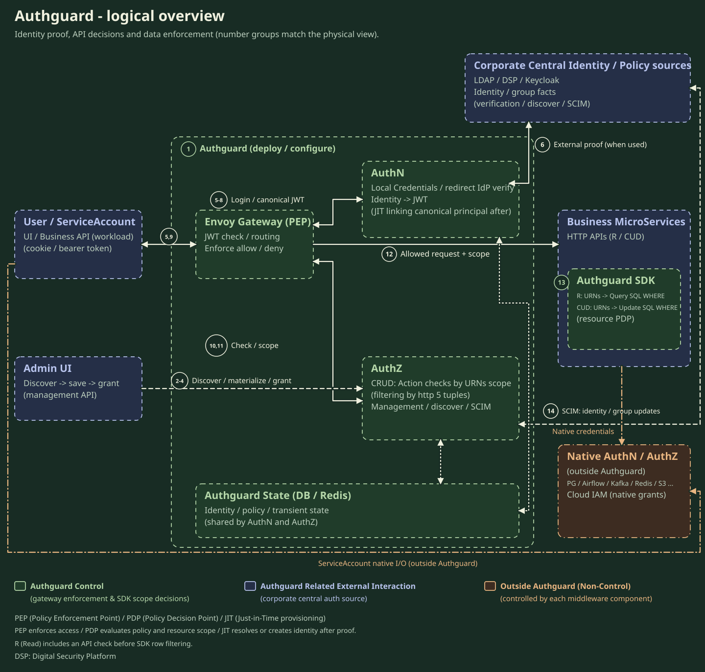

# AuthGuard Architecture Overview

The [unified AuthN/AuthZ specification](Authguard-AuthN-AuthZ-Whitepaper.md)
is the architecture reference. It separates target requirements from current implementation.

[Physical call diagram](assets/authguard-authn-authz-architecture.svg) · [View guide](Authguard-AuthN-AuthZ-Whitepaper.md#physical-view)

AuthGuard combines Envoy Gateway, AuthN, AuthZ, and Web within an application domain.
Envoy owns ingress and the edge PEP. AuthN verifies proofs, links identities, and issues
canonical JWTs. AuthZ evaluates API/resource policy; business SDKs derive and enforce
SQL/object constraints from its bounded scope.

AuthN supports standalone and LDAP password login. JIT resolves or creates the local
Principal/binding at verified login. Administrators can pull directory candidates and
materialize them before login; subsequent SCIM updates maintain identity/group facts.
See the [identity lifecycle](Authguard-AuthN-AuthZ-Whitepaper.md#identity-lifecycle) and
[terminology](Authguard-AuthN-AuthZ-Whitepaper.md#terminology).

Users and workload SAs both use AuthGuard for business API access. Direct SA access to
native resources uses product authentication and authorization outside AuthGuard.
See the [caller/target matrix](Authguard-AuthN-AuthZ-Whitepaper.md#access-matrix).

In enterprise deployments, DSP/SSO retains account authority. Approved LDAP/AD groups
provide corporate login/module ceilings; domain fine policy must remain inside those
ceilings. Directory discovery, SCIM, and reconciliation belong to the control plane.
Native database, broker, and cloud IAM permissions remain with their product PEPs.
Self-hosted grants use DBA/platform workflows; cloud grants use project IAM policy PRs
in `workload-iam-sot`, fulfilled by Terraform after merge.

One Keycloak installation may expose both SSO and Admin directory APIs; these are separate
interface roles. Its own authorization service is not the implicit resource PDP here.
The default deployment does not install Keycloak; configured login still depends on its
selected upstream provider. LDAP search bind is not LDAP user login.

Canonical identity is `(provider, issuer, subject) -> identity binding -> principal_id`.
AuthZ consumes stable USER/WORKLOAD/GROUP IDs, not provider credentials. Equal email
addresses never merge accounts. Standalone/first-login options belong to the general
profile and must not bypass corporate identity governance.

AuthN and AuthZ read one `authguard.yaml`, share canonical IAM persistence and transient
cache adapters, and retain separate module ownership. A B2C and a B2B trust domain need
independent issuers, keys, data, ingress, and capacity when isolation is required.

Business UI permission changes go through the AuthZ management API, persistence, and
revision publication. A database write alone does not activate policy on all replicas.

Important implementation gaps include the corporate admission ceiling, effective SCIM
membership/revocation, durable policy revisions and replica publication, scoped control
API credentials and custom DSP adapter composition. See the
[dated source review](Authguard-AuthN-AuthZ-Whitepaper.md#reference-implementation)
and [acceptance cases](Authguard-AuthN-AuthZ-Whitepaper.md#test-cases).
