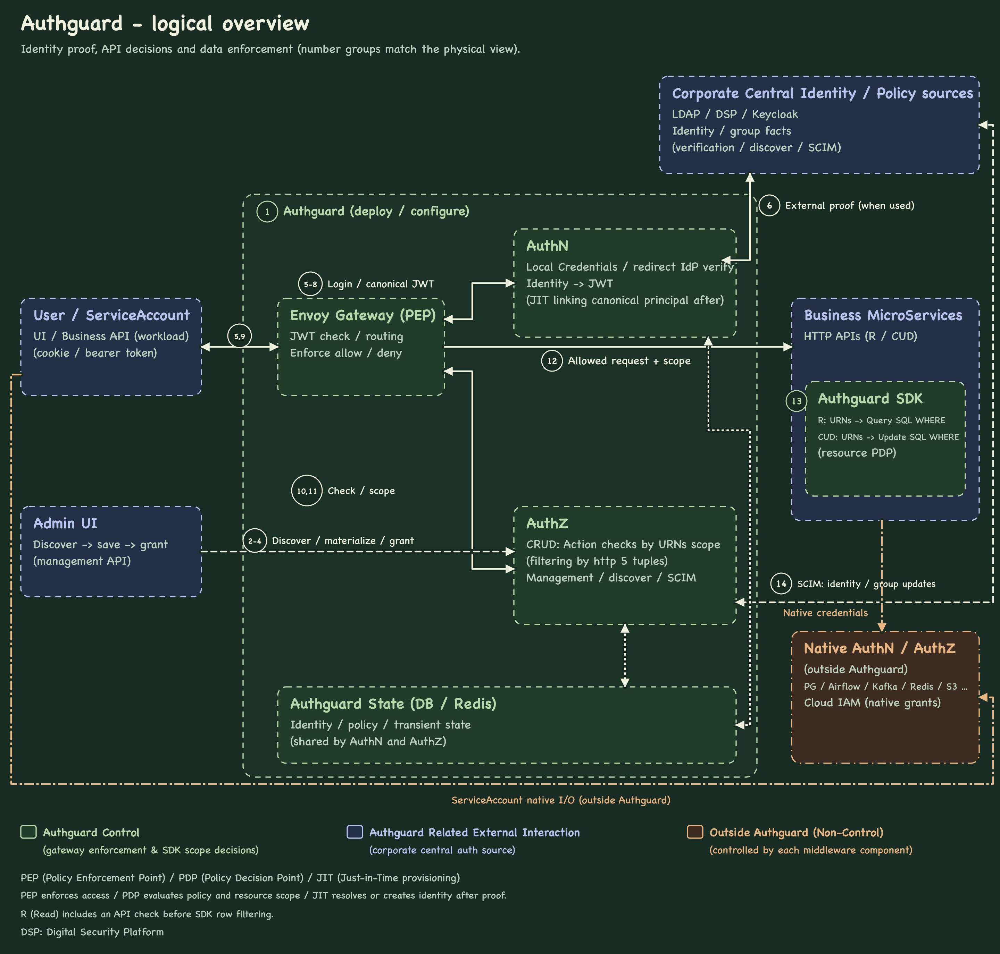

# AuthGuard 架构总览

[统一 AuthN/AuthZ 设计规范](Authguard-AuthN-AuthZ-Whitepaper_ZH.md)
是正式架构参考，并分别标明目标要求与当前实现。

[物理调用图](assets/authguard-authn-authz-architecture.jpg) · [双视图说明](Authguard-AuthN-AuthZ-Whitepaper_ZH.md#physical-view)

AuthGuard 在一个业务域内组合 Envoy Gateway、AuthN、AuthZ 与 Web。
Envoy 负责入口与 edge PEP；AuthN 验证证明、绑定身份并签发 canonical JWT；
AuthZ 计算接口/资源策略，业务 SDK 根据其 bounded scope 推导并执行 SQL/对象约束。

AuthN 支持 standalone 与 LDAP 密码登录。JIT 在验证身份后解析或创建本地 Principal/binding；
管理员也可先拉取目录候选并物化预授权，后续经 SCIM 更新身份/组事实。详见
[身份生命周期](Authguard-AuthN-AuthZ-Whitepaper_ZH.md#identity-lifecycle)和
[术语表](Authguard-AuthN-AuthZ-Whitepaper_ZH.md#terminology)。

用户和 workload SA 调用业务 API 都必须接入 AuthGuard。SA 直接访问原生资源时，
认证鉴权均由产品执行，不经过 AuthGuard。详见
[调用主体/目标矩阵](Authguard-AuthN-AuthZ-Whitepaper_ZH.md#access-matrix)。

企业模式中，DSP/SSO 保留账号权威，获批的 LDAP/AD group 构成登录/模块准入上限，
部门细粒度策略必须在此范围内。目录 discovery、SCIM 与 reconciliation 属于管理面；
数据库、broker 和云资源的原生权限仍由相应产品 PEP 执行。
自建资源由 DBA/平台团队授权；云权限在 `workload-iam-sot` 中按项目提交 IAM policy PR，
合并后由 Terraform 履约。

同一 Keycloak 可以提供 SSO 和 Admin 目录接口，两者是不同角色；其自带授权服务
不会自动成为本架构的资源 PDP。默认部署不安装 Keycloak，但已配置的登录仍依赖
所选上游。LDAP 搜索 SA bind 成功不等于完成 LDAP 用户登录。

Canonical 身份链路是 `(provider, issuer, subject) -> identity binding -> principal_id`。
AuthZ 只消费稳定 USER/WORKLOAD/GROUP ID，不消费 Provider 凭据；相同 email 不自动
合并账号。通用模式的 standalone/first-login 不得绕过企业账号治理。

AuthN 与 AuthZ 读取同一份 `authguard.yaml`，共享 canonical IAM 持久化与瞬态 cache
适配器，模块所有权分别保持独立。需要隔离的 2C/2B 域应使用独立 issuer、密钥、数据、
入口和容量边界。

业务 UI 修改细权限需经过 AuthZ 管理 API、持久化和 revision 发布；直接改库不能保证
全部副本立即生效。

集团准入上限、SCIM 成员关系参与判定与撤权、持久策略版本及跨副本发布、细分控制面
凭据和 custom DSP Adapter 组装仍有重要缺口。详见
[源码审查](Authguard-AuthN-AuthZ-Whitepaper_ZH.md#reference-implementation)与
[符合性用例](Authguard-AuthN-AuthZ-Whitepaper_ZH.md#test-cases)。
